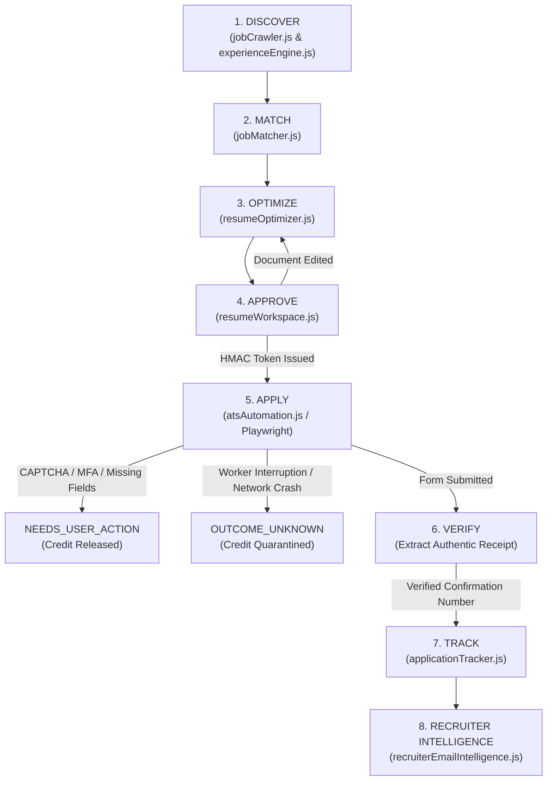

# ROLEVIA AI — AGENTIC FRAMEWORK AUDIT & ARCHITECTURAL EVALUATION
**Document Identifier:** AUDIT-004 — Agentic Framework & Orchestration Evaluation  
**Target:** LangChain / LangGraph Presence, Current AI Implementation & State Machine Architecture  
**Audit Baseline Commit:** `062dfeda021990f9a263f293efc8099f357dab65`  
**Date:** October 2026  
**Auditor:** Principal Software Architect & Agentic AI Systems Architect (Google Antigravity)

---

## 1. Executive Verdict & Core Findings

1. **Is LangChain or LangGraph Installed?**
   **NO.** Neither `langchain`, `@langchain/core`, `@langchain/langgraph`, `@langchain/community`, nor any related LangChain package is installed in `package.json` (root or frontend) or resolved in `package-lock.json`.
2. **Is LangChain or LangGraph Used in Any Execution Path?**
   **NO.** Zero imports of `langchain`, `langgraph`, `StateGraph`, `CompiledStateGraph`, or any LangChain module exist across any backend, frontend, test, or script file.
3. **Where Does "LangGraph" / "LangChain" Appear in the Codebase?**
   The only occurrences of the strings `"LangGraph"` and `"LangChain"` in the entire repository are located within `evidence/public-assets/page-BIjCOvf0.js` (line 1), which is a saved, archived client-side asset bundle from the primary competitor (**Tsenta AI**), where those terms appear as raw text in a public career advice guide detailing skills expected of an "AI Engineer" candidate.
4. **Current AI / LLM Reality:**
   Rolevia AI currently does **NOT** make live external API calls to commercial LLM providers (such as OpenAI, Anthropic, or Google Gemini). The entire system is powered by **high-performance, deterministic, rule-based algorithms, regular expressions, heuristic token matchers, FactStore citation ledgers, and procedural state machines**.
5. **Architectural Recommendation:**
   Adopting **LangGraph.js (`@langchain/langgraph`)** as an orchestration layer for the multi-step `Discover → Match → Optimize → Approve → Apply → Verify → Track` workflow offers substantial benefits for durable checkpointing, cyclic retries, and native human-in-the-loop gates. However, it must be introduced **incrementally as a wrapper** over our existing verified Node.js modules, preserving our PostgreSQL schema, credit ledger invariants, and Playwright adapters without a destabilizing rewrite.

---

## 2. Exhaustive Dependency & Import Audit

### 2.1 Package Manifests Inspection
- **Root `package.json` (`file:///c:/Users/admin/OneDrive/Desktop/Tsenta%20Ai%20Clone/package.json`):**
  ```json
  "dependencies": {
    "@prisma/client": "^5.14.0",
    "bcryptjs": "^2.4.3",
    "jsonwebtoken": "^9.0.2",
    "pdf-lib": "^1.17.1",
    "pdf-parse": "^1.1.1",
    "pg": "^8.23.1",
    "zod": "^3.23.8"
  },
  "devDependencies": {
    "prisma": "^5.14.0"
  }
  ```
  *Result: Zero LangChain or LangGraph dependencies declared.*

- **Frontend `package.json` (`file:///c:/Users/admin/OneDrive/Desktop/Tsenta%20Ai%20Clone/frontend/package.json`):**
  ```json
  "dependencies": {
    "lucide-react": "^1.61.0",
    "react": "^19.3.1",
    "react-dom": "^19.3.1"
  }
  ```
  *Result: Zero LangChain or LangGraph dependencies declared.*

- **Root & Frontend `package-lock.json`:**
  - Case-insensitive search for `"langchain"`: **0 matches**.
  - Case-insensitive search for `"langgraph"`: **0 matches**.

### 2.2 Source Code Symbol Search
Across all 281 tracked files in the workspace:
| Symbol / Module Pattern | Files Searched | Matches in Production Code | Matches in Tests / Scripts | Notes |
| :--- | :---: | :---: | :---: | :--- |
| `langchain` | All | 0 | 0 | Found only in Tsenta competitor asset (`evidence/public-assets/page-BIjCOvf0.js:1`) |
| `@langchain/core` | All | 0 | 0 | None |
| `@langchain/langgraph` | All | 0 | 0 | None |
| `StateGraph` | All | 0 | 0 | None |
| `CompiledStateGraph` | All | 0 | 0 | None |
| `langgraph` | All | 0 | 0 | None |

---

## 3. Inventory of Current AI Providers, Prompts, Models & Orchestration

### 3.1 External LLM Provider Integrations
- **Active Commercial API Calls:** **None.** (Zero SDK imports for `@google/genai`, `openai`, `@anthropic-ai/sdk`, or `cohere-ai`).
- **Network Outbound Requests:** `fetch()` is used exclusively in `backend/jobCrawler.js:33` to test HTTP 200/404 health status of job URLs. Zero network calls are made to LLM inference endpoints.

### 3.2 Prompts & Generation Mechanisms
Instead of unconstrained LLM completions, Rolevia AI currently uses **FactStore-grounded template compilation and claim-level semantic validators**:
- **Resume Tailoring (`backend/resumeOptimizer.js`):**
  - Synthesizes tailored resume bullets by prioritizing existing verified highlights from `candidateProfile.facts` (FactStore) matching normalized job requirements.
  - Implements `validateSemanticClaimAssertions()` (`backend/resumeOptimizer.js:70-135`) which parses numbers, metrics, currency, percentages (`extractMetricTokens`), and technical skills (`extractMentionedSkills`).
  - **Zero-Hallucination Policy:** Throws `HallucinationViolationError` if any metric, skill, or claim is not verbatim present in the candidate's verified FactStore highlights.
- **Cover Letter Generation (`backend/resumeOptimizer.js:460-520`):**
  - Compiles structured business letters using formal paragraph templates parameterized by candidate name, company, position, verified skills, and source fact citations.
- **Recruiter Draft Responses (`backend/recruiterEmailIntelligence.js:205-240`):**
  - Generates context-aware email replies (interview acceptance, assessment acknowledgment, offer reception) using structured templates.
  - All generated drafts are explicitly flagged `draftReplyStatus: 'DRAFT_PENDING_APPROVAL'` and require candidate authorization before sending.

### 3.3 Current Orchestration Mechanisms
Orchestration is currently implemented via **procedural state machines, database transaction boundaries, and event streams**:
1. **Application Lifecycle State Machine (`backend/applicationTracker.js`):**
   - 13 distinct application states: `DRAFT`, `OPTIMIZING`, `PENDING_REVIEW`, `APPROVED`, `QUEUED_RESERVED`, `RUNNING_PRE_SUBMIT`, `NEEDS_USER_ACTION`, `READY_FOR_SUBMISSION`, `SUBMISSION_IN_FLIGHT`, `SUBMITTED_CONFIRMED`, `OUTCOME_UNKNOWN`, `FAILED_CONFIRMED`, `SKIPPED`.
   - 6 pipeline stages: `APPLIED`, `SCREENING`, `INTERVIEWING`, `OFFER`, `REJECTED`, `WITHDRAWN`.
   - Transitions are persisted to PostgreSQL in `Application` and appended to the immutable audit trail `ApplicationEvent`.
2. **Cryptographic Candidate Authorization Gate (`backend/resumeWorkspace.js`):**
   - HMAC-SHA256 signature binding 8 immutable parameters: `userId`, `tenantId`, `applicationId`, `jobRequisitionHash`, `documentVersion`, `documentHash`, `timestamp`, `expiresAt`.
   - Execution is cryptographically blocked if the document is edited (`DOCUMENT_HASH_MISMATCH`) or token expires.
3. **Credit Accounting Orchestration (`backend/billing.js`):**
   - Double-entry ledger with 3 operational phases:
     - `APPLICATION_HOLD`: Reserves 1 credit before execution.
     - `APPLICATION_COMMIT`: Consumes credit only upon verified employer confirmation.
     - `APPLICATION_RELEASE`: Refunds credit on worker failure, pre-submit interruption, or escalation.
4. **Browser Automation Runner (`backend/atsAutomation.js`):**
   - Headless Playwright runner executing modular adapters (`GreenhouseAdapter`, `AshbyAdapter`, `LeverAdapter`).
   - Governed by `Promise.all([ page.waitForNavigation(), submitBtn.click() ])` and network synchronization.
5. **Real-Time Telemetry Stream (`backend/server.js`):**
   - Server-Sent Events (SSE) terminal (`/api/v1/applications/stream`) streaming real-time DOM step progression to the candidate dashboard.

---

## 4. Current End-to-End Workflow Mapping



### Detailed Execution Sequence
1. **DISCOVER (`backend/jobCrawler.js`):**
   - Ingests postings from Greenhouse, Ashby, and Lever feeds.
   - Computes canonical URL SHA-256 requisition hashes (`requisitionHash`) to deduplicate listings across aggregators.
   - Executes `extractExperienceRequirements()` (`backend/experienceEngine.js`) to classify roles into 7 experience categories (Fresher, 0-1y, 1-3y, 3-5y, 5-8y, 8y+) with graduation year and degree equivalence constraints.
2. **MATCH (`backend/jobMatcher.js`):**
   - Evaluates hard eligibility constraints (work authorization, location, degree level, experience bounds).
   - Produces 3-state output (`ELIGIBLE`, `INELIGIBLE`, `NEEDS_VERIFICATION`).
   - Computes explainable compatibility score: Skills (40%), Preferred Skills (20%), Experience (25%), Education (15%).
3. **OPTIMIZE (`backend/resumeOptimizer.js`):**
   - Fetches verified accomplishments from PostgreSQL `FactStore`.
   - Reranks bullets and formats job-specific resume and cover letter diffs.
   - Validates semantic claims: ensures every metric and skill maps to a verified source fact ID.
4. **APPROVE (`backend/resumeWorkspace.js`):**
   - Renders original vs tailored diff in interactive workspace.
   - Candidate approves document; server hashes active content (`SHA-256`) and generates HMAC-SHA256 authorization token.
   - If candidate edits any bullet, approval is immediately invalidated (`DOCUMENT_HASH_MISMATCH`).
5. **APPLY (`backend/atsAutomation.js`):**
   - Validates HMAC authorization token and reserves 1 credit (`APPLICATION_HOLD`).
   - Launches headless Playwright browser in either `DRY_RUN` (default staging) or `LIVE` (authorized submit) mode.
   - Modular adapter maps fields, attaches temporary resume, validates non-empty inputs, and submits form.
   - Escalates immediately to `NEEDS_USER_ACTION` upon encountering Workday multi-step portals, CAPTCHAs, or unsupported questions.
6. **VERIFY (`backend/atsAutomation.js` & `backend/applicationTracker.js`):**
   - Awaits post-submit navigation and scans DOM for authentic confirmation strings and requisition IDs.
   - Zero synthetic IDs: if no authentic receipt is detected, flags `confirmationNumber: null` and transitions to `OUTCOME_UNKNOWN`.
   - On confirmed receipt, commits credit (`APPLICATION_COMMIT`) and issues 4-tier receipt.
7. **TRACK (`backend/applicationTracker.js`):**
   - Updates PostgreSQL `Application` record with verified receipt and moves to 5-column Kanban pipeline (`APPLIED`).
   - Streams lifecycle events over Server-Sent Events (SSE).
8. **RECRUITER INTELLIGENCE (`backend/recruiterEmailIntelligence.js`):**
   - Ingests incoming emails via encrypted token OAuth (Gmail / Microsoft Graph).
   - Filters spam/digests and classifies messages into `INTERVIEW_INVITE`, `TECHNICAL_ASSESSMENT`, `OFFER`, `REJECTION`.
   - Links messages to applications, updates stages, and prepares candidate draft replies.

---

## 5. Classification of Deterministic Services vs AI Agents

| System Component | Target Agent ID | Current Implementation Paradigm | Deterministic or AI? | Implementation Status |
| :--- | :--- | :--- | :---: | :---: |
| **Candidate FactStore & Resume Parsing** | `AGENT-001` | PDF text parsing, regex entity extraction, heuristic quality scoring | **Deterministic** | Implemented (FEAT-003) |
| **Job Discovery & Requisition Crawler** | `AGENT-002` | ATS feed ingestion, canonical SHA-256 deduplication, HTTP freshness scanning | **Deterministic** | Implemented (FEAT-005) |
| **Eligibility & Matching Engine** | `AGENT-003` | Weighted multi-factor matrix, regex experience classification, 3-state logic | **Deterministic** | Implemented (FEAT-006/016) |
| **Resume Tailoring Agent** | `AGENT-004` | FactStore highlight reranking, claim-level metric assertion validator | **Deterministic Rule-Based** | Implemented (FEAT-007) |
| **Cover Letter Drafting Agent** | `AGENT-005` | Formal structured templating parameterized by verified candidate facts | **Deterministic Template** | Implemented (FEAT-007) |
| **Screening Question Agent** | `AGENT-006` | FactStore question-answer mapper; escalates sensitive disclosures | **Deterministic / Proposed LLM** | Implemented (FEAT-009/011) |
| **ATS Navigation Agent** | `AGENT-007` | Modular Playwright adapters (Greenhouse, Ashby, Lever, BambooHR, SmartRecruiters) | **Deterministic Browser Engine** | Implemented (FEAT-009) |
| **Application Execution Agent** | `AGENT-008` | Cryptographic HMAC validation, concurrency locking, credit journal hold | **Deterministic State Machine** | Implemented (FEAT-009) |
| **Submission Verification Agent** | `AGENT-009` | DOM confirmation regex parsing, 4-tier receipt generator, quarantine gate | **Deterministic Rule-Based** | Implemented (FEAT-009/010) |
| **Application Tracker Agent** | `AGENT-010` | PostgreSQL Kanban pipeline, SSE terminal, multi-tenant receipt isolation | **Deterministic Reactive Store** | Implemented (FEAT-010) |
| **Recruiter Communication Agent** | `AGENT-011` | OAuth2 encryption, regex classification, application linker, draft replies | **Deterministic Heuristic** | Implemented (FEAT-011) |

---

## 6. LangGraph.js Technical Evaluation

### 6.1 Architectural Advantages
1. **Durable Checkpointing Across Asynchronous Boundaries:**
   Currently, application state persistence is handled procedurally in PostgreSQL via Prisma calls scattered across `atsAutomation.js`, `resumeWorkspace.js`, and `applicationTracker.js`. LangGraph's `@langchain/langgraph-checkpoint-postgres` provides automatic per-step state snapshots, allowing exact resumption if a worker crashes before submission.
2. **Native Human-in-the-Loop (`interrupt` / `resume`):**
   Rolevia AI strictly requires candidate intervention for:
   - Document approval (`FEAT-008`).
   - Live submission authorization (`FEAT-009`).
   - Screening questions requiring narrative or sensitive personal input (`AGENT-006`).
   - Workday or CAPTCHA challenges (`NEEDS_USER_ACTION`).
   LangGraph's native `interrupt()` function suspends graph execution cleanly and awaits an external command with payload, perfectly matching our candidate authorization architecture.
3. **Formal Cyclic Workflows & Recovery:**
   If a candidate modifies an approved document, the workflow must loop back to `OPTIMIZE` and invalidate previous approval tokens. LangGraph models cycles and conditional routing as first-class citizens (`graph.addConditionalEdges()`).
4. **Standardized Multi-Agent State Channels:**
   As we introduce dynamic LLM capabilities in Release 0.3 (such as open-ended screening questions and recruiter intent nuance), a centralized `StateGraph` channels state between agents cleanly without ad-hoc database polling.

### 6.2 Risks, Constraints & Costs
1. **Heavy Dependency Footprint:**
   Adding `@langchain/core` and `@langchain/langgraph` increases `node_modules` size and introduces potential dependency resolution conflicts.
2. **Async Latency & Complexity:**
   Wrapping simple deterministic services (e.g., job matching or SHA-256 deduplication) inside an asynchronous graph adds runtime overhead and debugging indirection without functional gain.
3. **Database Dual-Write Hazard:**
   Rolevia AI has a battle-tested PostgreSQL relational schema with foreign key cascades, tenant isolation, and transactional credit balancing. LangGraph checkpoints must **synchronize with**, not compete against, our existing `Application`, `ApplicationEvent`, and `CreditJournal` tables.

---

## 7. Recommended Incremental Integration Architecture

We recommend a **3-phase non-breaking adoption plan** that preserves our existing Node.js backend, Prisma ORM, credit accounting, and Playwright adapters:

### Phase 1: Define Rolevia Application Workflow State Schema (No Dependency Changes)
Define a pure JavaScript typed state contract (`backend/workflows/applicationWorkflowTypes.js`) that models our existing workflow state:
```javascript
// Candidate Application Workflow State
const initialWorkflowState = {
  tenantId: '',
  userId: '',
  jobId: '',
  applicationId: '',
  diffData: null,
  documentHash: '',
  authorizationToken: null,
  executionMode: 'DRY_RUN', // 'DRY_RUN' | 'LIVE'
  status: 'DRAFT',
  creditHeld: false,
  receipt: null,
  error: null
};
```

### Phase 2: Introduce LangGraph.js as Orchestrator for the Application Pipeline
Install `@langchain/langgraph` and `@langchain/core` specifically for the `backend/workflows/` orchestration layer:
- **Nodes wrap existing verified functions:**
  - `Node_Optimize`: Calls `resumeOptimizer.optimizeResumeForJob()`.
  - `Node_CandidateApproval`: Uses LangGraph `interrupt()` to await candidate HMAC approval.
  - `Node_ReserveCredit`: Calls `billing.holdCreditForApplication()`.
  - `Node_AutomateATS`: Calls `atsAutomation.executeApplicationWorkflow()`.
  - `Node_VerifyReceipt`: Evaluates authentic confirmation.
  - `Node_CommitOrReleaseCredit`: Finalizes credit transaction.
- **Edges encode our verified conditional branches:**
  - `shouldExecuteLive`: Checks if candidate signed live submission.
  - `checkSubmissionOutcome`: Routes to `TRACK` on confirmation or `QUARANTINE` on failure.

### Phase 3: Pluggable Model Layer for Selective LLM Inference
Where generative intelligence adds genuine candidate value (Screening Question narratives and Recruiter Email subtleties):
- Use `@langchain/core/language_models` or direct provider SDKs behind a unified adapter interface (`backend/ai/llmProvider.js`).
- Enforce strict validation: All model outputs must pass through our deterministic `validateSemanticClaimAssertions()` before being shown to the candidate.

---

## 8. Summary Audit Conclusion

- **LangChain / LangGraph Current Status:** **NOT INSTALLED / NOT USED.**
- **Current Architecture:** High-speed, deterministic, rule-based, and zero-hallucination compliant modular monolith.
- **Migration Feasibility:** Highly viable via an incremental, non-breaking wrapper approach in Release 0.3, leveraging LangGraph.js for durable workflow orchestration and human-in-the-loop interrupts while keeping our database, security invariants, and Playwright browser adapters fully intact.
