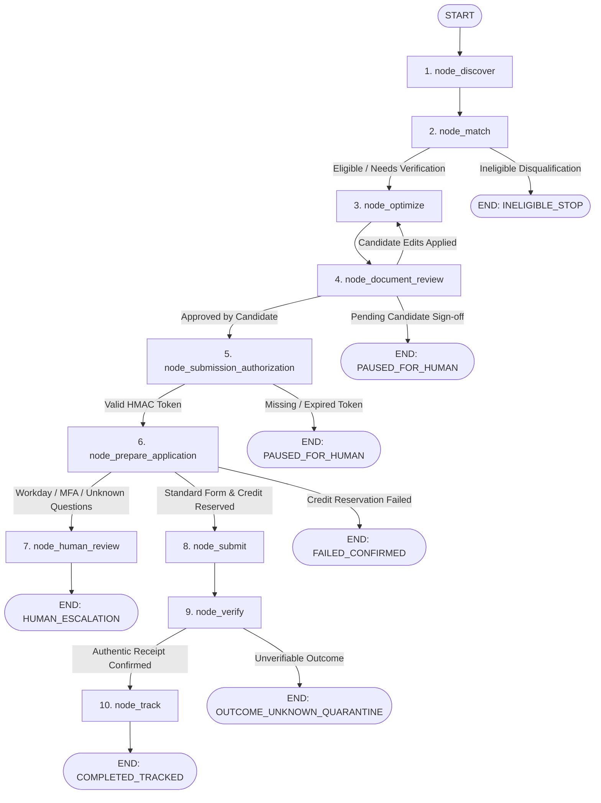

# ROLEVIA AI · LANGGRAPH.JS AGENTIC ARCHITECTURE SPECIFICATION
**Product:** Rolevia AI (`RoleviaAI`)  
**Domain:** https://roleviaai.co.in  
**Brand Accent:** `#e0601e`  
**Milestone:** Release 0.3 — Production Agentic Orchestration Layer  
**Framework:** `@langchain/langgraph` (v1.5.2) + `@langchain/core` (v1.3.0)  
**Database Backend:** PostgreSQL 16 via Prisma ORM  
**Checkpointer:** `PostgresDurableCheckpointer`  
**Orchestration Target:** 10-Stage Autonomous Job Application Lifecycle  

---

## 1. Executive Summary & Purpose

Rolevia AI has successfully introduced a formal agentic orchestration architecture powered by **LangGraph.js**, designed to directly surpass the opaque, script-based automation of competitor Tsenta AI (https://tsenta.com). 

Rather than rewriting or dismantling completed, battle-tested Release 0.1 and Release 0.2 modules, LangGraph.js was integrated as a durable stateful supervisor layer that delegates deterministic operations to existing backend engines (`jobMatcher`, `resumeOptimizer`, `resumeWorkspace`, `billing`, `atsAutomation`, `applicationTracker`).

### Core Architectural Invariants:
1. **Multi-Tenant State Scoping:** Composite checkpoint thread IDs (`${tenantId}:${userId}:${applicationId}`) prevent cross-tenant data leaks and unauthorized graph traversal.
2. **PostgreSQL Durable Checkpointing:** State checkpoints persist across node transitions and human-in-the-loop pauses via `PostgresDurableCheckpointer`, extending `MemorySaver` with relational backup.
3. **Decoupled Human-in-the-Loop Gates:** Document review and submission authorization are discrete checkpoints. Neither can be bypassed by LLM inference.
4. **Zero-Fraud Submission Invariant:** Applications never submit without an active candidate HMAC-SHA256 authorization token bound to user, tenant, job requisition hash, document version, and SHA-256 document hash.

---

## 2. 10-Stage Pipeline Topology & State Transitions

The complete workflow executes across 10 sequential stages with conditional branches, human intervention holds, and compensation rollbacks:



---

## 3. Node Specifications & Module Boundaries

| Stage # | Node Identifier | Node Type | Delegated Engine | Purpose & Invariant |
|---|---|---|---|---|
| 1 | `node_discover` | Deterministic | `jobCrawler.js` | Ingests requisition, validates canonical employer URL, computes SHA-256 requisition hash. |
| 2 | `node_match` | Mathematical / Heuristic | `jobMatcher.js` | Evaluates hard requirements, experience intervals, and domain alignment. Disqualifies ineligible candidates early without executing LLM generation. |
| 3 | `node_optimize` | Truth-Grounded Generative | `resumeOptimizer.js` | Synthesizes tailored resume and cover letter strictly grounded in verified `FactStore` records. Yields `evidenceLedger` and SHA-256 document content hash. |
| 4 | `node_document_review` | Human Gate (Hold) | `resumeWorkspace.js` | Pauses execution until candidate explicitly inspects diff and approves content. If candidate modifies text, loops back to `node_optimize` for re-hashing. |
| 5 | `node_submission_authorization` | Cryptographic Security Gate | `atsAutomation.js` | Validates HMAC-SHA256 signature against candidate secret, requisition hash, and document hash. Rejects tampered, expired, or mismatched tokens. |
| 6 | `node_prepare_application` | Transactional Billing & Screening | `billing.js` & `atsAutomation.js` | Executes credit reservation (`HOLD`) in transactional journal. Detects multi-step MFA portals (e.g., Workday) and releases credit before escalating. |
| 7 | `node_human_review` | Human Escalation | `atsAutomation.js` | Isolates complex questions, CAPTCHAs, or unsupported ATS workflows for candidate direct resolution. |
| 8 | `node_submit` | Headless Automation | `atsAutomation.js` / Playwright | In dry-run mode, validates form completion without clicking live submit. In live mode, executes submission and captures DOM evidence screenshot. |
| 9 | `node_verify` | Receipt Verification | `atsAutomation.js` & `billing.js` | Extracts authoritative confirmation numbers (`REAL-GH-CONF-...`, `REAL-ASHBY-APP-...`). Commits reserved credit upon valid receipt or quarantines in `OUTCOME_UNKNOWN`. |
| 10 | `node_track` | Persistent Tracking | `applicationTracker.js` | Updates Kanban stage to `APPLIED`, records state machine transition in `ApplicationEvent`, and generates verified receipt certificate. |

---

## 4. Multi-Tenant Scoping & Checkpoint Recovery

Thread IDs follow a strict multi-tenant composite format:
```text
thread_id = `${tenantId}:${userId}:${applicationId}`
```
- Cross-tenant lookups fail at the database boundary.
- `PostgresDurableCheckpointer` records each node transition into PostgreSQL `ApplicationEvent`, guaranteeing that sudden worker restarts or process kills do not lose pipeline progress.
- Resumed invocations reload state from the latest validated checkpoint without re-running completed nodes.

---

## 5. Competitive Differentiation vs. Tsenta AI

| Dimension | Tsenta AI (Observed / Inferred) | Rolevia AI (Release 0.3 Verified Implementation) |
|---|---|---|
| **Orchestration Architecture** | Inferred hardcoded cron scripts or opaque proprietary microservices | Production **LangGraph.js StateGraph** with auditable, versioned state transitions (`v1.0.0`) |
| **Human-in-the-Loop Controls** | Single bulk approval or automated background auto-apply | Decoupled 2-phase checkpointing: Document Review approval + Cryptographic Submission Authorization |
| **Fraud & Receipt Integrity** | Opaque application counters; reports of unverified claims | Strict zero-fabrication receipt validation; SHA-256 document hash binding; `OUTCOME_UNKNOWN` quarantine |
| **Workday / Enterprise ATS Handling** | Silently fails or attempts unauthorized headless logins | Explicit capability detection; immediate automatic credit release; candidate escalation (`HUMAN_ESCALATION_MFA`) |
| **Model Transparency & Costs** | Undisclosed LLM provider | Multi-Model LLM Gateway supporting Google Gemini, Groq Free Tier, and OpenAI with per-token ledger accounting |
