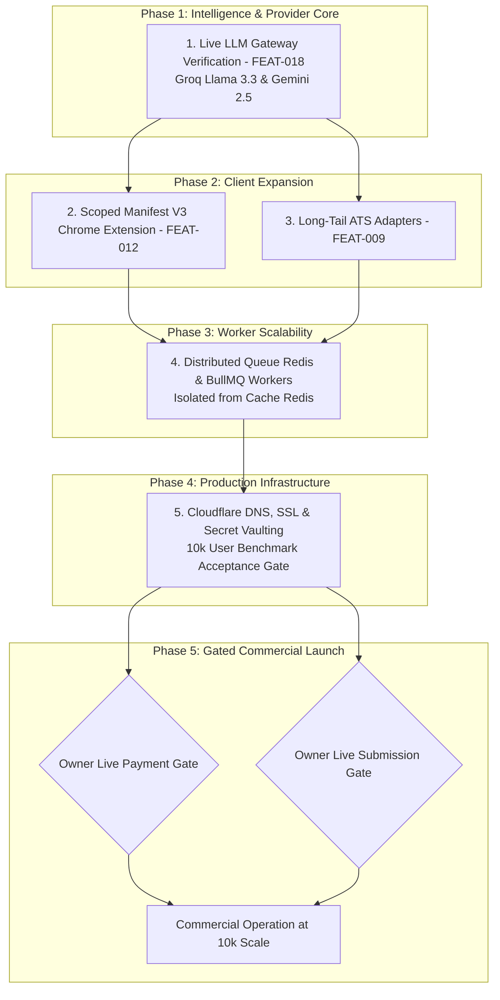

# ROLEVIA AI — RELEASE 0.4 DEPENDENCY-BASED IMPLEMENTATION PLAN & INTEGRITY GATES

**Product:** Rolevia AI (`RoleviaAI`)  
**Target Domain:** https://roleviaai.co.in  
**Primary Brand Accent:** `#e0601e`  
**Current Milestone State:** Release 0.4 Milestone 1: Database Migration Integrity, Gemini 2.5 Architecture & Revised 10k Scalability Strategy Accepted (246/246 Tests Passing Across 25 Suites)  
**Next Milestone:** Release 0.4 Milestone 2 — Real LLM Provider Integration & Manifest V3 Chrome Extension  
**Planning Date:** October 26, 2026  
**Auditor & Architect:** Principal Software Architect & Full-Stack Systems Lead (Google Antigravity)  
**Status:** **REVISED ENGINEERING PLAN APPROVED FOR STAGING IMPLEMENTATION**

---

## 1. Executive Summary & Critical Architectural Corrections

In accordance with project integrity reviews, the **Release 0.4 Engineering Plan** incorporates six fundamental architectural corrections:

1. **Commercial LLM Unit Economics & Supported Models (Correction 1):**
   Obsolete Gemini 1.5 and 2.0 Flash models (retired/shut down) are officially replaced with active Google models: `gemini-2.5-flash` ($0.075 / $0.30 per 1M tokens) and `gemini-2.5-pro` ($1.25 / $5.00 per 1M tokens). Commercial deployment requires paid-tier allocations to guarantee enterprise SLAs and verify that candidate resume data is **never used to train third-party foundation models**.
2. **Revised Scalability Strategy (Correction 2):**
   The initial production launch target is **10,000 simultaneously connected users** (~250 RPS). The architecture retains progressive scaling headroom (`10k -> 50k -> 100k -> 250k -> 500k -> 1M`), but premature hyperscale infrastructure (such as multi-region clusters or excessive database replicas) is rejected until measured demand justifies it.
3. **Queue Redis Durability vs Cache Separation (Correction 3):**
   To comply with BullMQ production requirements and prevent delayed job loss, dedicated **Queue Redis** (`maxmemory-policy=noeviction` + AOF persistence) is strictly separated from disposable **Cache Redis** (`maxmemory-policy=allkeys-lru`).
4. **Authoritative Forward-Only Migrations (Correction 4):**
   Prisma Migrate is the sole authoritative production migration mechanism. Schema changes in production are strictly forward-only and additive (`ALTER TABLE ... ADD COLUMN`); destructive table drops are prohibited.
5. **Scoped Extension Security Architecture (Correction 5):**
   The Manifest V3 Chrome Extension (`FEAT-012`) is strictly forbidden from reading, storing, or sharing raw website JWT access tokens. Authentication will use a **scoped, revocable extension token** (`rolevia_ext_auth_*`) granting restricted permissions exclusively for job extraction and candidate-confirmed tab autofill.
6. **Decoupled Commercial Authorization Gates (Correction 6):**
   Neither Razorpay live payment capture nor live employer ATS submissions will be enabled as an automatic part of production deployment. Both remain **isolated, explicit approval gates** requiring separate project owner authorization.

---

## 2. Dependency-Based Implementation Sequence

### Phase 1: Live LLM Gateway Verification (`FEAT-018`)
- **Prerequisites:** Valid paid commercial API keys injected in developer environment (`GROQ_API_KEY`, `GEMINI_API_KEY`).
- **Deliverables:**
  1. Live network execution of `tests/test_live_llm_validation.js` against Groq On-Demand (`llama-3.3-70b-versatile`) and Gemini 2.5 Flash Paid (`gemini-2.5-flash`).
  2. Latency, token usage, and simulated per-application cost metrics recorded in audit logs.
  3. Automatic intra-provider fallback from Groq to Gemini 2.5 under HTTP 429 rate limit conditions.
  4. Enterprise data confidentiality compliance check (confirming model training exclusions).

### Phase 2: Scoped Manifest V3 Chrome Extension (`FEAT-012`)
- **Prerequisites:** `FEAT-002` (Auth), `FEAT-005` (Job Ingestion).
- **Security Invariant:** Zero access to raw website cookies or root JWT tokens.
- **Deliverables:**
  1. `/api/v1/auth/extension-token`: Endpoint issuing short-lived, revocable extension tokens with scoped permissions (`jobs:import`, `profile:autofill_read`).
  2. In-page overlay widget on LinkedIn, Indeed, and Glassdoor displaying match score and missing skill warnings.
  3. Client-side form autofill helper mapping FactStore fields into third-party ATS inputs with explicit candidate confirmation.

### Phase 3: Long-Tail ATS Adapters & Assisted Navigation (`FEAT-009`)
- **Prerequisites:** `FEAT-009` baseline runner, `FEAT-017` LangGraph checkpointer.
- **Deliverables:**
  1. BambooHR native adapter (`*.bamboohr.com`).
  2. SmartRecruiters native adapter (`jobs.smartrecruiters.com`).
  3. Workday assisted-navigation helper modal guiding candidate through account creation and CAPTCHA challenges without fragile DOM hacking.

### Phase 4: Distributed Redis & BullMQ Worker Architecture
- **Prerequisites:** `FEAT-017` PostgreSQL Durable Checkpointer (`backend/workflows/postgresCheckpointer.js`).
- **Deliverables:**
  1. Decouple Playwright browser jobs from the Express web server process into an isolated worker pool (25–30 workers at launch).
  2. Dedicated Queue Redis (`noeviction`, AOF) for BullMQ queues and locks, strictly separated from Cache Redis (`allkeys-lru`).
  3. Redis worker heartbeat monitoring and automatic orphaned lock reclamation via `reconcileOrphanedSubmissionLocks`.

### Phase 5: Production Infrastructure & 10k Launch Benchmark
- **Prerequisites:** Cloudflare account, domain control confirmation (`roleviaai.co.in`).
- **Deliverables:**
  1. Cloudflare DNS configuration with strict SSL (TLS 1.3, HSTS, HTTP/3).
  2. Centralized secrets management (cloud vaulting for database connection strings and OAuth credentials).
  3. OpenTelemetry performance tracing without high-cardinality labels on metrics.
  4. Reproducible 10,000 concurrent user / 250 RPS load test passing lightweight API p95 < 180 ms.

---

## 3. Explicit Launch Blockers & Quality Acceptance Criteria

| Workstream | Launch Blocker Condition | Quality Acceptance Criteria |
| :--- | :--- | :--- |
| **LLM Gateway** (`FEAT-018`) | Live API keys absent or unverified in network tests. | `tests/test_live_llm_validation.js` passes with 100% schema compliance on Gemini 2.5 / Groq and zero unsupported candidate claims. |
| **Data Privacy** | Model provider terms allow training on candidate resumes. | Commercial agreements verified ensuring zero prompt/resume retention for foundation model training. |
| **Extension Security** (`FEAT-012`) | Extension reads or exposes raw website JWT access tokens. | Extension uses scoped, revocable tokens (`rolevia_ext_auth_*`); candidate can revoke extension access in 1 click. |
| **Submission Idempotency** | Database race condition allows duplicate application submission. | PostgreSQL `submission_attempt_locks` table with unique constraint on `(tenant_id, user_id, requisition_key)` rejects competing workers. |
| **Commercial Billing** | Live merchant activation executed automatically without owner signoff. | Formal written signoff from project owner; sandbox test suite passes all double-entry ledger invariants. |
| **Employer Submissions** | Live applications dispatched without explicit candidate authorization. | High-friction candidate confirmation modal with SHA-256 document approval token enforced prior to any real submit dispatch. |
| **10k Load Benchmark** | System fails under 10k concurrent connections or 250 RPS. | k6 benchmark validates p95 latency < 180ms, 0% queue corruption, and zero 5xx error spikes under sustained load. |

---

## 4. Rollback Strategy & Staging Boundaries

1. **Staging Isolation:** All ATS adapters continue to execute in `DRY_RUN` mode by default (`ROLEVIA_AUTOMATION_MODE=DRY_RUN`).
2. **Billing Isolation:** Razorpay operates under test credentials (`rzp_test_*`) with mock webhook verification.
3. **Process Isolation:** Worker crashes are quarantined at the queue level without affecting web API responsiveness.
4. **Forward-Only Database Changes:** Production schema management strictly uses forward migrations; destructive drops are prohibited.
5. **Instant Feature Toggles:** All new capabilities (Chrome Extension bridge, BambooHR adapter, SmartRecruiters adapter) are gated behind database feature flags.
