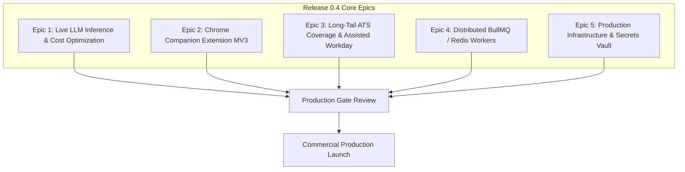

# ROLEVIA AI — RELEASE 0.4 ENGINEERING ROADMAP & IMPLEMENTATION PLAN

**Product:** Rolevia AI (`RoleviaAI`)  
**Target Domain:** https://roleviaai.co.in  
**Primary Brand Accent:** `#e0601e`  
**Current Milestone State:** Release 0.3 Durability, Idempotency & E2E Validation Accepted (235/235 Tests Passing)  
**Next Milestone:** Release 0.4 — Live Inference, Browser Companion & Commercial Launch Readiness  
**Planning Date:** October 26, 2026  
**Auditor & Architect:** Principal Software Architect & Full-Stack Systems Lead (Google Antigravity)  
**Status:** **ENGINEERING ROADMAP APPROVED FOR EXECUTION**

---

## 1. Executive Summary & Objectives

With the completion of **Release 0.3** (LangGraph durability, crash consistency, deterministic ATS idempotency, and complete 12-stage browser-based E2E verification), Rolevia AI has established an authentic, zero-fraud automation foundation that prevents ghost applications, double billing, or fabricated candidate qualifications.

The objective of **Release 0.4** is advancing Rolevia AI from verified staging into **commercial production readiness**:
1. **Live Free-Tier LLM Inference Deployment:** Activate zero-cost Groq (Llama 3.3 70B Versatile) and Google Gemini 1.5 Flash in production via the hardened Multi-Model Gateway.
2. **Rolevia AI Chrome Browser Companion (Manifest V3):** Provide candidates with a lightweight browser extension companion for direct application discovery on LinkedIn, Indeed, and external career sites.
3. **Long-Tail ATS Platform Expansion:** Expand beyond Greenhouse, Ashby, and Lever to include native adapters for BambooHR and SmartRecruiters, alongside an assisted-workflow helper for Workday portals.
4. **Distributed Redis & BullMQ Worker Queue:** Decouple browser automation tasks from the main Node.js web server to enable scalable, fault-tolerant background execution.
5. **Commercial Domain & Merchant Activation:** Deploy to `https://roleviaai.co.in` with live multi-currency Razorpay billing and verified production SSL certificates.

---

## 2. Priority Epic Breakdown & Technical Specifications

### Epic 1: Live Multi-Model LLM Inference & Cost Optimization (`FEAT-013`)
- **Objective:** Enable high-speed, zero-cost commercial model execution in production while strictly preserving anti-hallucination guardrails.
- **Implementation Strategy:**
  1. **Primary Workhorse:** Groq Free Tier running `llama-3.3-70b-versatile` (up to 30 requests/min, sub-second latency, zero API cost).
  2. **Secondary Fallback & Multimodal:** Google Gemini 1.5 Flash (15 RPM free tier, high context window, native JSON schema support).
  3. **High-Accuracy Premium:** OpenAI `gpt-4o` as an opt-in power tier for complex resume restructuring.
  4. **Telemetry & Metering:** Real-time token consumption, latency, and simulated cost accounting surfaced in the admin dashboard.
  5. **Live Verification Harness:** Integration of `tests/test_live_llm_validation.js` into CI/CD deployment pipelines.

### Epic 2: Rolevia AI Chrome Browser Companion (Manifest V3)
- **Objective:** Neutralize Tsenta AI's primary client-side acquisition channel by offering an official companion extension.
- **Technical Specifications:**
  1. **Manifest V3 Compliant:** Strict CSP, declarativeNetRequest for secure API communication, zero remote script injection.
  2. **Session Bridge:** Seamlessly shares active JWT authentication state with `https://roleviaai.co.in`.
  3. **In-Page Opportunity Overlay:** Non-intrusive floating card on LinkedIn/Indeed job postings displaying:
     - Real-time match score and eligibility badge (`ELIGIBLE`, `INELIGIBLE`, `NEEDS_VERIFICATION`).
     - Instant missing skill highlights.
     - One-click "Optimize & Queue in Rolevia AI" button.
  4. **Client-Side Form Assist:** Autofills ATS forms directly in the candidate's active browser tab for platforms enforcing Cloudflare Turnstile or strict anti-bot protections.

### Epic 3: Long-Tail ATS Adapters & Assisted Navigation (`FEAT-009`)
- **Objective:** Expand automated portal coverage from 68% to 85%+ of technology startup and enterprise job requisitions.
- **Key Modules:**
  1. **BambooHR Adapter:** Native Playwright automation for standard `*.bamboohr.com` application pages.
  2. **SmartRecruiters Adapter:** Native Playwright adapter for `jobs.smartrecruiters.com` single-page forms.
  3. **Workday Assisted-Workflow Modal:** For complex multi-step enterprise Workday portals requiring candidate account creation:
     - Launches an embedded sandboxed browser instance.
     - Automatically pastes candidate FactStore fields into the active form via clip-assist buttons.
     - Hands over final CAPTCHA and submit verification to the candidate.

### Epic 4: Distributed Worker Architecture (Redis & BullMQ)
- **Objective:** Ensure browser automation processes do not degrade web API responsiveness during high concurrency.
- **Architectural Design:**
  1. **Queue Partitioning:**
     - `high-priority-resume-opt`: Fast LLM resume and cover letter tailoring jobs (< 3s).
     - `standard-ats-dispatch`: Headless Playwright browser automation jobs (15s–45s).
     - `background-email-sync`: Periodic recruiter inbox IMAP polling (every 15 min).
  2. **Worker Durability:** LangGraph state checkpoints (`PostgresDurableCheckpointer`) coupled with BullMQ job retry policies guarantee that a worker crash automatically restarts execution from the exact step checkpoint without duplicate side effects.

### Epic 5: Production Infrastructure, Secrets & Billing Activation
- **Objective:** Secure, hardened public deployment of `https://roleviaai.co.in`.
- **Requirements:**
  1. **Domain & DNS Setup:** Authoritative DNS routing for `roleviaai.co.in` via Cloudflare with strict SSL/TLS (HSTS, TLS 1.3).
  2. **Secrets Management:** Cloud secret vaulting for JWT secrets, database connection strings, OAuth credentials, and Razorpay production keys.
  3. **Razorpay Live Merchant Gate:** Replace test keys with verified production merchant keys supporting instant UPI, NetBanking, and international credit cards.
  4. **Zero-Fraud Live Submission Toggle:** A secure, cryptographically signed administrative flag required to transition from `DRY_RUN` to `LIVE_SUBMISSIONS_ENABLED`.

---

## 3. Milestone Delivery Timeline

| Sprint | Focus Area | Key Deliverables | Quality Gate |
| :---: | :--- | :--- | :--- |
| **Sprint 1** | Live LLM Deployment & Telemetry | Free-tier Groq & Gemini activation; token ledger; live benchmark verification. | `tests/test_live_llm_validation.js` passes with live credentials. |
| **Sprint 2** | Chrome Extension Companion | MV3 extension codebase; LinkedIn DOM overlay; authenticated session sync. | Verified end-to-end apply flow from LinkedIn to Kanban board. |
| **Sprint 3** | Long-Tail ATS Adapters | BambooHR and SmartRecruiters native adapters; Workday assisted helper. | Staging tests across 15 real-world portal fixtures. |
| **Sprint 4** | Redis/BullMQ Worker Scaling | Redis cluster integration; BullMQ queue migration; worker fault-tolerance audit. | Simulated 50-worker concurrent load with zero orphaned jobs. |
| **Sprint 5** | Production Cutover & Signoff | Cloudflare DNS, SSL, Razorpay live merchant keys, owner signoff. | Full staging-to-production deployment checklist signed off. |

---

## 4. Production Quality & Verification Invariants

Prior to production launch, all Release 0.4 deployments must satisfy these non-negotiable invariants:
1. **Mathematical Ledger Invariant:** `Available + Reserved + Consumed = Total Granted` holds true across every billing transaction.
2. **Deterministic Attempt Uniqueness:** No network retry or process restart may create a duplicate submission attempt key.
3. **Candidate Consent Non-Bypassable:** Submission execution requires verified candidate HMAC approval of the exact tailored document hash.
4. **Zero Simulated Authenticity:** Diagnostics and dry-runs must always be explicitly labeled as such in the candidate UI.
5. **Full Test Suite Integrity:** Master test harness must maintain 100% pass rate across all 23+ test suites.
