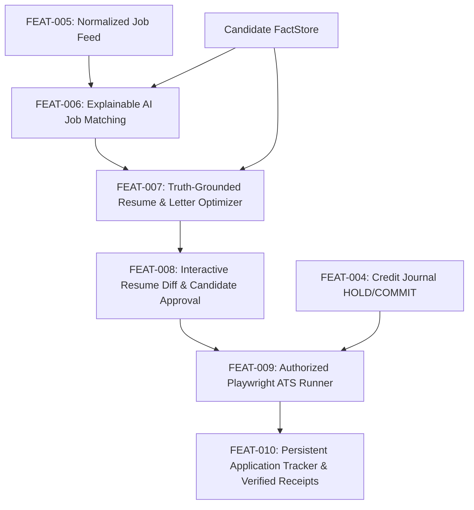

# ROLEVIA AI · RELEASE 0.2 IMPLEMENTATION PLAN
**Architecture**: Modular Monolith with FactStore Verification Layer  
**Product Working Brand**: RoleviaAI  
**Target Domain**: [roleviaai.co.in](https://roleviaai.co.in)  
**Release Target**: Release 0.2 Intelligence & Application Automation Engine  
**Evaluated Date**: October 2026  

---

## 1. Release 0.2 Scope & Executive Architecture

Release 0.2 transforms Rolevia AI from a validated foundational platform (PostgreSQL 16, multi-tenant auth, resume fact store, triple-reconciled credit journal, multi-source ingestion) into an **intelligence and assisted application engine**.

### Safety & Compliance Guardrails (Mandatory)
1. **Zero Real-World Application Submissions**: All external ATS form interactions in development/testing operate against sandboxed test endpoints or dry-run mock pages. No live employer portals will receive automated submissions without explicit user authorization.
2. **Zero Real-Money Transactions**: Razorpay billing integration remains in test/sandbox HMAC mode.
3. **Truth-Grounding Guarantee**: No hallucinated facts, altered employment dates, or invented skills. Every generated resume claim must link directly to an existing verified FactStore record (`Fact.status == 'VERIFIED'`).
4. **Candidate Approval Gate**: Submissions can NEVER proceed autonomously. FEAT-008 enforces explicit candidate human-in-the-loop sign-off on every diff before FEAT-009 runner execution.

---

## 2. Feature Backlog & Specifications

### FEAT-006: Explainable AI Job Matching
- **Objective**: Replace opaque, arbitrary percentage scores with transparent, multi-factor mathematical job compatibility scoring.
- **Components**:
  1. **Hard Eligibility Filter**:
     - Work authorization / sponsorship requirements (e.g. US Citizen / Green Card / Requires Sponsorship).
     - Location & remote policy (Onsite vs Hybrid vs Remote country matching).
     - Minimum required years of professional experience.
     - Hard knockout check: If ineligible, status is `INELIGIBLE` with clear explanation.
  2. **Multi-Factor Compatibility Score (0–100)**:
     - **Required Skills Match (40%)**: Jaccard & semantic overlap of candidate verified skills vs job required skills.
     - **Preferred Skills Match (20%)**: Bonus overlap for preferred/nice-to-have skills.
     - **Role Seniority & Experience Fit (25%)**: Alignment of candidate total verified years against required band (Junior, Mid, Senior, Lead, Staff).
     - **Domain & Education Alignment (15%)**: Field of study, degree level, or sector background.
  3. **Explainability Breakdown**:
     - Matched skills list with confidence ratings.
     - Missing required skills and missing preferred skills.
     - Experience gap analysis (e.g. "Candidate has 6 years, role asks 5+ years: +25pts").
     - Clear, actionable candidate recommendation ("Strong fit for systems backend; lacking Kubernetes certification").

---

### FEAT-007: Truth-Grounded Resume and Cover Letter Optimization
- **Objective**: Generate tailored, ATS-readable resume variants and cover letters targeted at a specific job description without inventing or exaggerating facts.
- **Safety Enforcement**:
  - Ingests verified facts from `FactStore` (`Fact` model in PostgreSQL).
  - Strict grounding constraint: Only verified accomplishments, skills, and dates may appear in the generated document.
  - Zero-Hallucination Assertion: Post-generation fact-checker scans generated text against candidate FactStore; any ungrounded assertion throws `HallucinationViolationError`.
- **ATS Readability Assurance**:
  - Generates linear single-column layout or structured Markdown/PDF that guarantees high ATS readability score (> 90/100).
  - Standard headers (`Work Experience`, `Education`, `Technical Skills`).

---

### FEAT-008: Interactive Resume Diff and Approval
- **Objective**: Give candidates full visual control and line-by-line approval over every AI-generated modification before an application is submitted.
- **Capabilities**:
  - Visual side-by-side or inline diff highlighting added, removed, or rephrased bullet points.
  - Granular accept/reject per bullet point or section.
  - Version history linked to the specific job requisition.
  - Cryptographic hash signature recorded upon candidate approval (`approvalSignature = HMAC(approvedContent, candidateSecret)`).

---

### FEAT-009: Authorized Playwright ATS Application Runner
- **Objective**: Automate the tedious form-filling process across Greenhouse, Ashby, and Lever (with Workday adapter foundation) using Playwright.
- **Workflow & Guardrails**:
  1. Dry-Run / Headless mode by default.
  2. Form field mapping (Name, Email, Phone, Resume upload, LinkedIn, Custom Questions).
  3. Pre-fill verification: Displays completed form fields to candidate for confirmation.
  4. Human-in-the-loop authorization token required before form `submit` click.
  5. Integration with FEAT-004 Credit Journal: Holds credit before runner starts, verifies confirmation receipt before commit, releases on failure, quarantines on `OUTCOME_UNKNOWN`.

---

### FEAT-010: Persistent Application Tracker and Verified Receipts
- **Objective**: Track application lifecycle states with irrefutable cryptographic submission receipts and status history.
- **Capabilities**:
  - State machine: `DRAFT` → `HOLD_CREDIT` → `FORM_FILLED` → `SUBMITTED` / `OUTCOME_UNKNOWN` / `FAILED`.
  - Verified Receipt: Stores confirmation ID, submission timestamp, HTTP response status, screenshot hash, and ATS application link.
  - Recruiter status sync: Updates as recruiter status evolves (Viewed, Interview, Offer, Rejected).

---

## 3. Immediate Milestone: FEAT-006 Implementation
As recommended, work commences immediately on **FEAT-006: Explainable AI Job Matching**.
- Module: `backend/jobMatcher.js`
- Test Suite: `tests/test_feat006_matcher.js`
- Verification Criteria:
  1. Hard eligibility filtering (work authorization, location, experience).
  2. Multi-factor score computation (0–100) with explainable component weights.
  3. Transparent reasoning generation (matched skills, skill gaps, experience breakdown).
  4. Integration with PostgreSQL job and user fact records.
