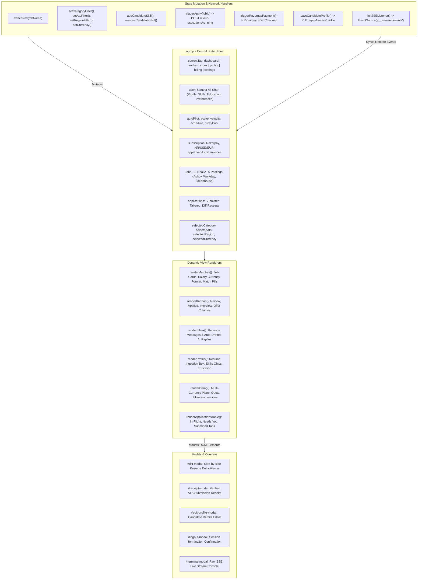
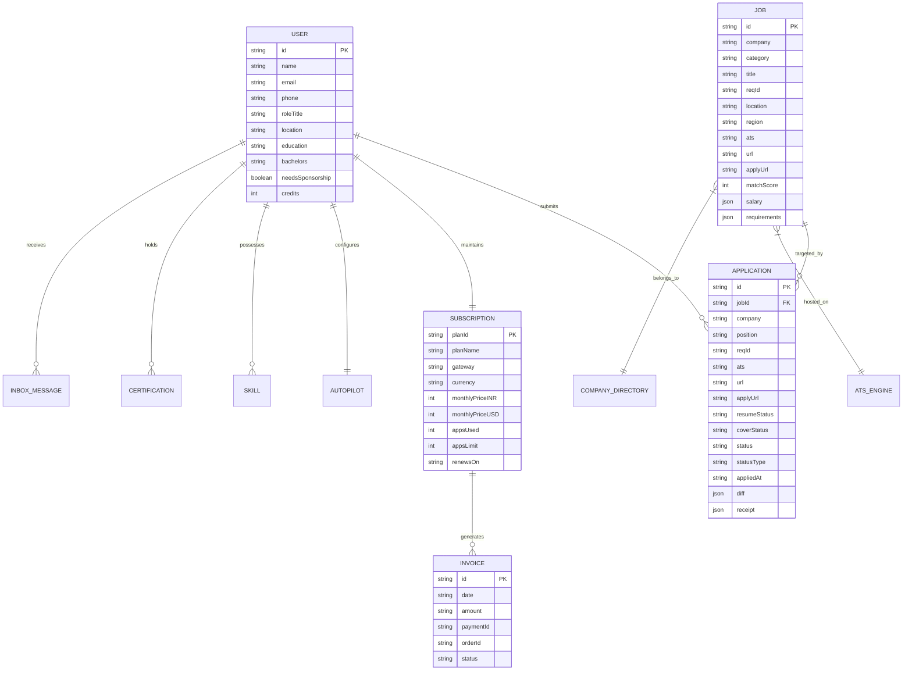
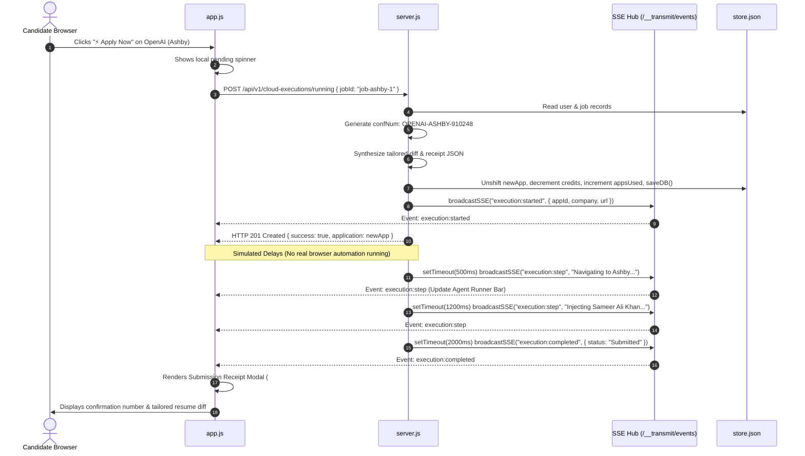
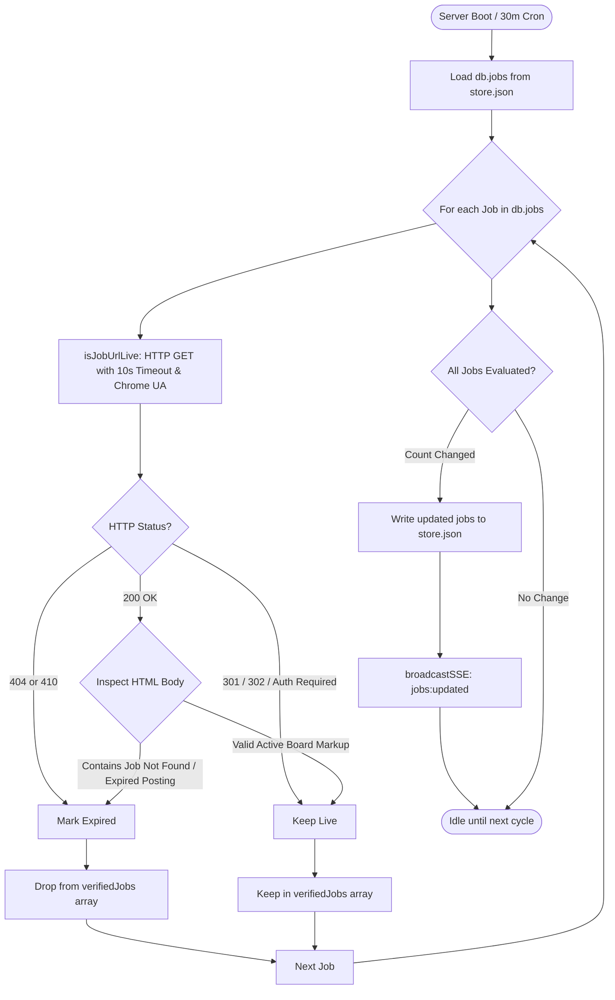

# REPORT 2 — Existing Architecture Documentation
**Platform**: Autonomous AI Job Search & Application Platform (Tsenta AI Clone)  
**Date**: October 24, 2026  
**Auditor Role**: Principal Software Architect & Systems Designer  
**Scope**: Codebase reverse engineering, state flow mapping, component topology, and execution contracts

---

## 1. High-Level System Architecture

The existing implementation consists of a single monolithic Node.js process serving both static frontend assets and REST/SSE endpoints over HTTP on port 3000, interacting with an in-memory JSON document persisted to disk (`store.json`).

```mermaid
graph TD
    UserBrowser["Candidate Web Browser (Chrome/Safari/Edge)"]
    
    subgraph FrontendLayer ["Client Layer (Port 3000)"]
        UI_HTML["index.html (Semantic Structure & Modals)"]
        UI_CSS["styles.css (Claymorphic Design Tokens)"]
        UI_JS["app.js (State Machine, Rendering & Fetch APIs)"]
    end
    
    subgraph BackendLayer ["Native Node.js Server Layer (server.js)"]
        Router["HTTP Request Router & Static File Handler"]
        SSE_Engine["AdonisJS Transmit SSE Hub (/__transmit/events)"]
        HealthChecker["isJobUrlLive & purgeExpiredJobs (10s Timeout)"]
        
        subgraph APIRoutes ["REST API Gateway (/api/v1)"]
            AuthRoute["/auth/logout"]
            UserRoute["/users/me & /users/profile"]
            SkillsRoute["/candidate/skills (POST / DELETE)"]
            ResumeRoute["/resume/parse (Auto-Parse PDF)"]
            JobsRoute["/jobs/recommendations & /jobs/verify-live"]
            AppsRoute["/applications & /cloud-executions/running"]
            BillingRoute["/subscription/razorpay/create-order & verify-payment"]
            AutopilotRoute["/autopilot/toggle"]
        end
    end

    subgraph DataLayer ["Persistence & File Assets"]
        JSONStore[("store.json (In-Memory Database)")]
        ATSConfig["ats_engines.json (Supported ATS Specs)"]
        CompanyDir["company_directories.json (1,358 Companies)"]
        ResumePDF["Sameer_Ali_Khan_Resume.pdf (Master PDF)"]
    end

    subgraph ExternalServices ["External Ecosystem"]
        RazorpayGateway["Razorpay Payments API (rzp_test_...)"]
        EmployerBoards["Live Employer ATS Boards (Ashby, Workday, Greenhouse)"]
    end

    UserBrowser -->|HTTP GET / & Assets| Router
    UserBrowser -->|SSE Subscription| SSE_Engine
    UserBrowser -->|REST API Calls| APIRoutes
    
    Router --> StaticFiles["Static Root"]
    StaticFiles --> UI_HTML
    StaticFiles --> UI_CSS
    StaticFiles --> UI_JS
    StaticFiles --> ResumePDF

    APIRoutes <-->|Read / Write State| JSONStore
    APIRoutes <-->|Read Config| ATSConfig
    APIRoutes <-->|Read Directories| CompanyDir
    APIRoutes <-->|File Stats & Existence| ResumePDF
    
    HealthChecker -->|Headless HTTP GET (10s)| EmployerBoards
    BillingRoute -.->|Simulated Orders| RazorpayGateway
    AppsRoute -.->|Simulated Execution (No Headless Driver)| EmployerBoards
    SSE_Engine -->|Real-time Telemetry Push| UserBrowser
```

---

## 2. Detailed Frontend Architecture

The client application is built as an interactive Single-Page Application (SPA) driven by a single mutable JavaScript state object (`state` in `app.js`).



---

## 3. Database Entity Relationship Diagram (ERD)

The current platform persists state in `backend/database/store.json`. The structural entities and their relationships are modeled as follows:



---

## 4. API Request / Response Sequence Diagrams

### 4.1 Application Trigger & Live Execution Flow (`/cloud-executions/running`)



### 4.2 Candidate Skill Addition & Deletion Flow

```mermaid
sequenceDiagram
    autonumber
    actor Candidate as Candidate
    participant UI as Profile UI
    participant Client as app.js
    participant Server as server.js
    participant DB as store.json
    participant SSE as SSE Hub

    Candidate->>UI: Types "FastAPI" and clicks "+ Add Skill"
    UI->>Client: addCandidateSkill()
    Client->>Server: POST /api/v1/candidate/skills { skill: "FastAPI" }
    Server->>DB: Check uniqueness; db.user.skills.push("FastAPI"); saveDB()
    Server->>SSE: broadcastSSE("user:updated", { user: db.user })
    Server-->>Client: HTTP 200 OK { success: true, skills: [...] }
    Client->>UI: Re-renders #candidate-skills-list with interactive "✕" chip
    
    Candidate->>UI: Clicks "✕" on "FastAPI"
    UI->>Client: removeCandidateSkill("FastAPI")
    Client->>Server: DELETE /api/v1/candidate/skills { skill: "FastAPI" }
    Server->>DB: db.user.skills.filter(...); saveDB()
    Server->>SSE: broadcastSSE("user:updated", { user: db.user })
    Server-->>Client: HTTP 200 OK { success: true, skills: [...] }
    Client->>UI: Updates skills list immediately
```

---

## 5. Job Discovery and Health Check Pipeline



---

## 6. Implementation Status Matrix

| Component / Subsystem | Status | Technical Details |
|---|---|---|
| **Top Navigation & Profile Logout** | **Implemented & Working** | Buttons in nav, profile card, session card; opens confirmation modal `#logout-modal`; calls `/api/v1/auth/logout`. |
| **Interactive Skills CRUD** | **Implemented & Working** | Inline addition, `✕` deletion, backend validation, JSON persistence, and SSE broadcast. |
| **Profile Metadata Editor** | **Implemented & Working** | Modal dialog `#edit-profile-modal` updating Name, Role, Education, Sponsorship via `PUT /api/v1/users/profile`. |
| **Live Job URL Health Check** | **Implemented & Working** | `isJobUrlLive` inspects status codes and error title tags with 10s timeout; runs preflight & 30m cron. |
| **Multi-Currency Pricing UI** | **Implemented & Working** | Switcher between ₹ INR, $ USD, and € EUR; dynamic plan updates in Billing Hub. |
| **Resume PDF Parsing Endpoint** | **Partially Implemented (Mock Engine)** | Validates `Sameer_Ali_Khan_Resume.pdf` file size via `fs.statSync`, but returns a static pre-parsed JSON response without running real NLP/OCR. |
| **ATS Job Application Runner** | **Partially Implemented (Simulated)** | Generates structured application receipts, diffs, and SSE logs; **does NOT launch headless browser automation**. |
| **Razorpay Subscription Gateway** | **Partially Implemented (Mock Orders)** | Generates order tokens (`order_...`); **does NOT verify cryptographic HMAC signatures or webhook signatures**. |
| **Job Scraping & Ingestion Engine** | **Partially Implemented (Static Catalog)** | Contains 1,358 company portal links in `company_directories.json` and 12 live jobs; **lacks active scraper workers**. |
| **Multi-Tenant User Auth (JWT/Bcrypt)** | **Completely Missing** | No registration, login, password hashing, token validation, or user isolation. |
| **Relational Database & Migrations** | **Completely Missing** | Relies entirely on `backend/database/store.json`; no PostgreSQL, Prisma, or SQLite models. |
| **Browser Extension & MCP Interface** | **Completely Missing** | Reverse-engineered Tsenta contracts exist in `evidence/`, but no extension manifest or MCP server is built. |
| **Recruiter Email Tracking Engine** | **Completely Missing (Mock Display Only)** | Inbox displays hardcoded mock messages; no IMAP/Gmail API integration. |
