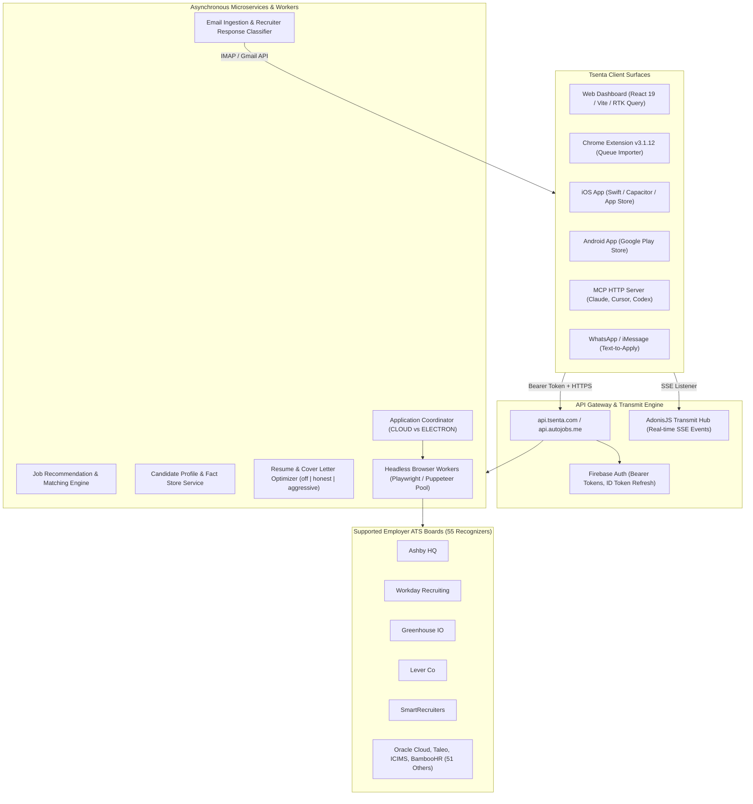

# REPORT 4 — Tsenta Competitive Intelligence
**Subject**: Tsenta ([tsenta.com](https://tsenta.com/)) / AutoJobs ([autojobs.me](https://autojobs.me/))  
**Analysis Date**: October 24, 2026  
**Auditor Role**: Principal Reverse Engineer & Competitive Intelligence Analyst  
**Evidence Base**:
- 236 decompiled production bundle assets (`evidence/public-assets/`)
- Static API & Route Inventory (`research/static-api-analysis.md`, `research/static-api-routes.json`)
- Public Workflow Discovery (`research/public-workflows.md`)
- Subscription Architecture Extraction (`research/subscription-blueprint.md`)
- Reverse Engineering Artifacts (`evidence/rea-analysis-complete.json`, `evidence/rea-doctor.json`)

---

## 1. System Topology & Ecosystem Overview

Tsenta operates as a multi-surface AI agent platform across **Web, Chrome Extension, Mobile Apps (iOS/Android), and Model Context Protocol (MCP)** clients, backed by an asynchronous cloud worker pool.



---

## 2. Core Functional Capabilities Breakdown

### A. Job Discovery & Feed Engine
- **Volume & Source**: Claims indexation of 8.5M+ postings across 1,300+ employer sites, Greenhouse, Ashby, and Workday.
- **Filtering Capabilities**:
  - Seniority: Intern, Entry, Mid, Senior, Director, Executive.
  - Workplace: Remote (Worldwide, US, Regional), Hybrid, On-site.
  - Role Families: 20 standardized role families (`SOFTWARE_ENGINEERING`, `BACKEND`, `PYTHON`, `DATA_SCIENCE`, etc.).
  - Work Authorization & Sponsorship: Explicit toggle for Visa Sponsorship Required.
  - Posting Recency: 6 hours, 24 hours, 7 days, 14 days, 30 days.
- **Normalization**: Automatically maps messy employer job titles into standard taxonomies and tags required skills.

### B. AI Job Matching & Explainability
- **Candidate Fact Store**: Maintains verified user profile data (education, work experience, projects, skills, certifications, work authorization).
- **Match Scoring**:
  - Does not rely solely on arbitrary percentages; evaluates **Hard Eligibility Constraints** (degrees, graduation dates, visa sponsorship eligibility, geographic location).
  - Generates semantic fit scores and highlights **Skill Gaps** directly on job cards (e.g., "Missing: Kubernetes, Kafka").

### C. Resume & Cover Letter Optimization
- **Optimization Modes**: Shipped bundles define three distinct optimization modes:
  - `off`: Submits master resume unmodified.
  - `honest`: Reorders, tightens, and highlights existing candidate qualifications matching job keywords; strictly preserves factual truth without inventing claims.
  - `aggressive`: Generates highly tailored framing emphasizing target ATS keywords and synthesizes custom cover letters.
- **Diff Context Engine** (`diff_context-DEJUYbzj.js`):
  - Produces structured JSON diffs with `del` and `add` lines for candidate bullet points.
  - Side-by-side visual diff viewer allows candidates to review, edit, or reject proposed resume modifications before submission.
- **Document Generation**: Dynamically compiles tailored ATS-standard single-column PDFs via headless rendering (`/api/v1/applications/{id}/resume-download-url`).

### D. Automated Job Application Execution
- **State Machine Lifecycle** (`applicationsApi-qbeQj421.js`):
  ```
  OPTIMIZING -> OPTIMIZING_RESUME / OPTIMIZING_CL 
             -> PENDING_REVIEW (RESUME / CL / SUBMIT) 
             -> READY (Queued) 
             -> RUNNING (Browser Worker Active) 
             -> COMPLETED / SKIPPED / FAILED
  ```
- **Execution Target**: Shipped code supports `executionTarget: CLOUD | ELECTRON | null`.
  - Cloud execution runs on server-side headless browser workers with clean residential proxy IP pools.
  - Local desktop execution handles platforms requiring local user cookies or device context.
- **Review Before Submit** (July 1 feature): Pre-submission pause presenting:
  - Form answers filled by AI.
  - Tailored resume and cover letter.
  - Explicit candidate approval button before the final submit button is triggered on the employer ATS.
- **Verified Receipts**: Emits structured confirmation tokens, timestamps, application URLs, and answer logs upon completion.

### E. Application Tracking & Recruiter Intelligence
- **Kanban Tracker**: Stages: Review Needed, Queued, Submitted, Interview, Offer, Rejected.
- **Recruiter Response Ingestion** (`inbox-Bxl-cU5q.js`):
  - Integrates with user email (Gmail/IMAP) to detect incoming recruiter responses.
  - Classifies messages into Interview Requests, Technical Assessments, or Rejections.
  - Auto-drafts contextual replies for candidate approval.

---

## 3. Subscription & Commercial Blueprint

*Source: `subscriptionApi-D1butwwh.js` and `research/subscription-blueprint.md`*

- **Providers**: Dodo Payments (Global Cards/Netbanking), RevenueCat (Apple In-App Purchases / Google Play), and Enterprise.
- **Tier Structure**:
  - **Starter**: $19/mo (approx. 600 applications/mo)
  - **Pro**: $39/mo (approx. 1,500 applications/mo)
  - **Power / Enterprise**: $99/mo (approx. 4,500 applications/mo)
- **Credit Accounting**: Billed on **confirmed application submissions**. Failed executions or skipped applications receive automatic credit refunds. Monthly allowances do not roll over.

---

## 4. Observed Weaknesses & Defects in Competitor Platform

1. **Posting Freshness Bugs**: Observed job postings displaying inconsistent timestamps (e.g., directory listing says "Just now", while job detail renders `Posted-3282 days ago`).
2. **Duplicate Postings**: Adjacent job cards for identical employer requisitions appear in the public feed without server-side deduplication.
3. **Workday Automation Friction**: Developer notes acknowledge ongoing challenges with Workday portal account creation and multi-step CAPTCHA challenges, requiring occasional user intervention (`NEEDS_USER_ACTION`).
4. **No Native Multi-Currency Billing**: Tsenta primarily prices in USD ($), creating billing friction for international job seekers in India (INR) and Europe (EUR).
