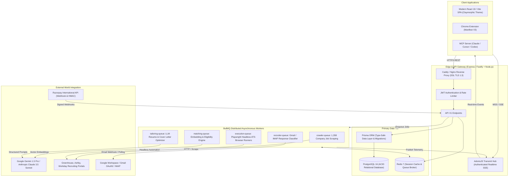
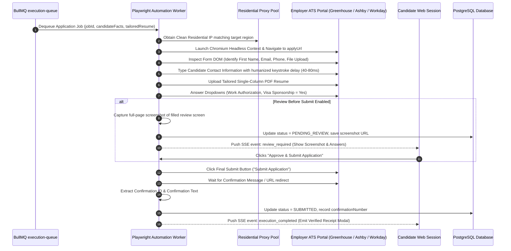

# REPORT 7 — Production Architecture Proposal
**Platform**: Autonomous AI Job Search & Application Platform (Tsenta AI Clone)  
**Date**: October 24, 2026  
**Auditor Role**: Principal Software Architect & Infrastructure Engineer  

---

## 1. Target Production Architecture Topology

To evolve from a monolithic single-process demo into a resilient, scalable, production-grade SaaS capable of supporting thousands of concurrent candidate auto-pilot applications, the platform will adopt a **modular event-driven architecture**.



---

## 2. Production Database Schema Design (Prisma / PostgreSQL)

```prisma
datasource db {
  provider = "postgresql"
  url      = env("DATABASE_URL")
}

generator client {
  provider = "prisma-client-js"
}

model User {
  id                String          @id @default(uuid())
  email             String          @unique
  passwordHash      String
  fullName          String
  phone             String?
  location          String?
  roleTitle         String?
  yearsExp          Float           @default(0)
  needsSponsorship  Boolean         @default(false)
  preferredLocations String[]
  targetRoleFamilies String[]
  credits           Int             @default(50)
  createdAt         DateTime        @default(now())
  updatedAt         DateTime        @updatedAt

  resumeProfiles    ResumeProfile[]
  skills            CandidateSkill[]
  applications      Application[]
  subscription      Subscription?
  autoPilotConfig   AutoPilotConfig?
}

model ResumeProfile {
  id             String         @id @default(uuid())
  userId         String
  user           User           @relation(fields: [userId], references: [id], onDelete: Cascade)
  profileName    String         @default("Master Profile")
  isDefault      Boolean        @default(true)
  pdfUrl         String
  fileSizeBytes  Int
  atsReadiness   Int            @default(95)
  rawParsedText  String         @db.Text
  structuredFacts Json          // Education, Experience, Projects, Certifications
  createdAt      DateTime       @default(now())
  updatedAt      DateTime       @updatedAt

  applications   Application[]
}

model CandidateSkill {
  id        String   @id @default(uuid())
  userId    String
  user      User     @relation(fields: [userId], references: [id], onDelete: Cascade)
  name      String
  category  String   @default("Technical") // Framework, Language, Cloud, Tool
  years     Float?
  createdAt DateTime @default(now())

  @@unique([userId, name])
}

model Job {
  id              String        @id @default(uuid())
  externalId      String?       // ATS Requisition ID
  company         String
  category        String        // startup | product | service
  logoUrl         String?
  title           String
  location        String
  region          String        // global | us | emea | apac
  sponsorship     Boolean       @default(false)
  ats             String        // greenhouse | ashby | workday | lever | smartrecruiters
  url             String        @unique
  applyUrl        String?
  department      String?
  salaryMin       Float?
  salaryMax       Float?
  currency        String        @default("USD")
  requirements    String[]
  rawDescription  String        @db.Text
  isLive          Boolean       @default(true)
  lastCheckedAt   DateTime      @default(now())
  createdAt       DateTime      @default(now())

  applications    Application[]
}

model Application {
  id                 String           @id @default(uuid())
  userId             String
  user               User             @relation(fields: [userId], references: [id], onDelete: Cascade)
  jobId              String
  job                Job              @relation(fields: [jobId], references: [id])
  resumeProfileId    String
  resumeProfile      ResumeProfile    @relation(fields: [resumeProfileId], references: [id])
  
  status             ApplicationStatus @default(QUEUED)
  tailoredResumeData Json?            // Structured bullet diffs
  tailoredPdfUrl     String?
  coverLetterText    String?          @db.Text
  confirmationNumber String?
  executionLog       Json?            // Timestamps, steps, screenshots
  submittedFields    Int              @default(0)
  appliedAt          DateTime?
  createdAt          DateTime         @default(now())
  updatedAt          DateTime         @updatedAt
}

enum ApplicationStatus {
  OPTIMIZING
  PENDING_REVIEW
  QUEUED
  RUNNING
  SUBMITTED
  FAILED
  INTERVIEW
  OFFER
  REJECTED
}

model Subscription {
  id                 String             @id @default(uuid())
  userId             String             @unique
  user               User               @relation(fields: [userId], references: [id], onDelete: Cascade)
  planId             String             // starter | pro | power
  planName           String
  currency           String             @default("INR") // INR | USD | EUR
  priceCents         Int
  appsLimit          Int
  appsUsed           Int                @default(0)
  status             SubscriptionStatus @default(ACTIVE)
  razorpaySubId      String?
  currentPeriodStart DateTime           @default(now())
  currentPeriodEnd   DateTime
  createdAt          DateTime           @default(now())
  updatedAt          DateTime           @updatedAt

  invoices           Invoice[]
}

enum SubscriptionStatus {
  ACTIVE
  PAUSED
  PAST_DUE
  CANCELLED
}

model Invoice {
  id                 String       @id @default(uuid())
  subscriptionId     String
  subscription       Subscription @relation(fields: [subscriptionId], references: [id], onDelete: Cascade)
  amount             Int          // In smallest currency unit
  currency           String
  razorpayPaymentId  String?
  razorpayOrderId    String?
  status             String       @default("PAID")
  paidAt             DateTime     @default(now())
}

model AutoPilotConfig {
  id              String   @id @default(uuid())
  userId          String   @unique
  user            User     @relation(fields: [userId], references: [id], onDelete: Cascade)
  active          Boolean  @default(false)
  dailyVelocity   Int      @default(30)
  minSalaryUSD    Int      @default(100000)
  preferredATS    String[] @default(["greenhouse", "ashby", "workday"])
  schedule        String   @default("09:00 - 18:00 EST")
  reviewBeforeSubmit Boolean @default(true)
}
```

---

## 3. Headless Browser Automation Architecture (Playwright Pool)



---

## 4. Truth-Grounded LLM Prompting Contract

To ensure 100% factual accuracy and prevent AI hallucinations:
1. **System Prompt Constraint**:
   > "You are an ATS Optimization Assistant. You must NEVER fabricate work experience, employment dates, degrees, certifications, or metrics. You may only rephrase, reorder, and highlight existing candidate facts provided in the Candidate Fact Store to align with target keywords."
2. **Input Envelope**: Target Job Description + Candidate's Master Fact Store.
3. **Structured Output (Zod Schema)**:
   ```typescript
   const ResumeDiffSchema = z.object({
     role: z.string(),
     del: z.string().describe("Original bullet point from candidate facts"),
     add: z.string().describe("ATS-aligned rewrite strictly preserving original factual claims"),
     rationale: z.string().describe("Why this keyword rephrasing improves ATS ranking")
   });
   ```
