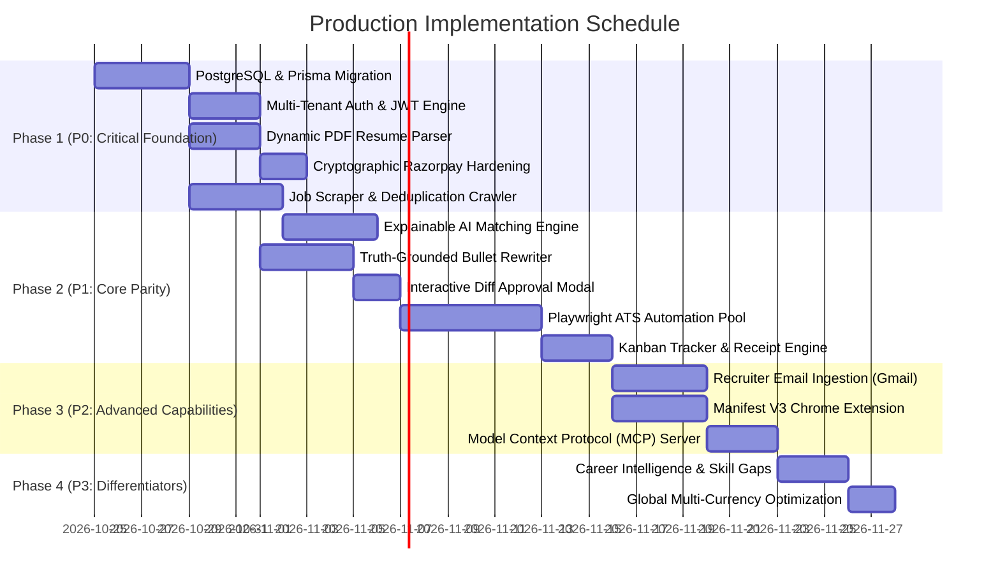

# REPORT 8 — Implementation Roadmap & Architecture Decision Records
**Platform**: Autonomous AI Job Search & Application Platform (Tsenta AI Clone)  
**Date**: October 24, 2026  
**Auditor Role**: Principal Software Architect & Technical Program Manager  

---

## 1. Prioritized Implementation Roadmap

Following the user's priority directives and our architectural audit, features are partitioned into four disciplined execution phases:

---

## 2. Detailed Milestone Breakdown

### Milestone 1: P0 — Critical Foundation (Days 1–8)
1. **P0-1: PostgreSQL & Prisma Migration**:
   - *Current*: Flat JSON file `store.json`.
   - *Deliverable*: PostgreSQL schema with User, ResumeProfile, CandidateSkill, Job, Application, Subscription tables; Prisma migration scripts.
   - *Acceptance Criteria*: Zero race conditions under 100 concurrent requests; ACID transaction integrity.
2. **P0-2: Multi-Tenant Authentication & Session Security**:
   - *Current*: Single hardcoded user; no login screen.
   - *Deliverable*: Signup/login endpoints, bcrypt password hashing, JWT Bearer tokens, HTTP-only refresh cookies, protected API middleware.
   - *Acceptance Criteria*: Unauthenticated requests to `/api/v1/users/*` return HTTP 401; passwords stored hashed.
3. **P0-3: Dynamic PDF Resume Parsing & Fact Store**:
   - *Current*: Static metadata returned regardless of uploaded file.
   - *Deliverable*: `pdf-parse` / `unpdf` integration extracting plain text + Gemini/Claude extraction returning validated candidate facts.
   - *Acceptance Criteria*: Uploading any candidate resume extracts contact, degree, GPA, employment, and skills with >95% accuracy.
4. **P0-4: Cryptographic Razorpay Verification**:
   - *Current*: Client parameters accepted without cryptographic verification.
   - *Deliverable*: Server-side HMAC-SHA256 signature verification (`order_id|payment_id`) and webhook secret verification.
   - *Acceptance Criteria*: Forged payment payloads rejected with HTTP 400; valid payments upgrade subscription atomically.
5. **P0-5: Continuous Job Ingestion & Deduplication**:
   - *Current*: 12 static jobs + 1,358 company directory links.
   - *Deliverable*: Background crawler for Greenhouse, Ashby, and Workday APIs with hash-based requisition deduplication.
   - *Acceptance Criteria*: Fresh jobs populated automatically; duplicate listings purged.

### Milestone 2: P1 — Core Product Parity (Days 9–18)
1. **P1-1: Explainable AI Job Matching**:
   - *Current*: Static keyword match percentages (93-98%).
   - *Deliverable*: Vector embeddings + hard constraint evaluator (degree requirements, graduation year, visa sponsorship).
   - *Acceptance Criteria*: Match score accurately reflects eligibility; explicit missing skills displayed.
2. **P1-2: Truth-Grounded Per-Job Resume Optimization**:
   - *Current*: Pre-canned static diff text.
   - *Deliverable*: LLM prompting pipeline operating in `honest` mode; rewrites candidate bullets with zero hallucinations.
   - *Acceptance Criteria*: Injected keywords come only from the target job description; no fabricated job history.
3. **P1-3: Resume Diff Viewer & Candidate Approval**:
   - *Current*: Read-only diff modal.
   - *Deliverable*: Editable diff viewer allowing candidates to modify or reject specific bullet rewrites.
   - *Acceptance Criteria*: Candidate edits persist into the final submitted resume version.
4. **P1-4: Playwright Headless ATS Application Runner**:
   - *Current*: `setTimeout` simulated SSE logs.
   - *Deliverable*: Real Playwright browser automation pool with dedicated adapters for Greenhouse, Ashby, and Workday.
   - *Acceptance Criteria*: Successfully submits a test application on a real staging ATS board, captures screenshots, and extracts official confirmation tokens.
5. **P1-5: Application Queue & Dynamic Kanban Tracker**:
   - *Current*: Mock Kanban display.
   - *Deliverable*: Drag-and-drop Kanban tracker synced to database status with exportable PDF receipts.
   - *Acceptance Criteria*: Moving cards updates database; receipt modals link to live URLs.

### Milestone 3: P2 — Advanced Capabilities (Days 19–25)
1. **P2-1: Recruiter Email Ingestion & Status Classifier**:
   - *Current*: Hardcoded mock messages in `app.js`.
   - *Deliverable*: Gmail OAuth2 / IMAP background listener detecting recruiter replies and classifying into Interview, Assessment, or Rejection.
2. **P2-2: Manifest V3 Chrome Extension**:
   - *Deliverable*: Chrome extension detecting ATS postings on LinkedIn and company career sites, queueing jobs into the user's dashboard.
3. **P2-3: Model Context Protocol (MCP) Server**:
   - *Deliverable*: Stdio and HTTP MCP server enabling Claude Code, Cursor, and Codex CLI to search jobs, trigger tailoring, and check application status.

### Milestone 4: P3 — Differentiators (Days 26–30)
1. **P3-1: Career Intelligence & Skill Gap Analysis**:
   - *Deliverable*: Aggregated market analysis identifying top in-demand skills for target roles with curated learning links.
2. **P3-2: Advanced Global Multi-Currency Localization**:
   - *Deliverable*: Purchasing Power Parity (PPP) pricing rules for India, APAC, Europe, and North America.

---

## 3. Architecture Decision Records (ADRs)

### ADR-001: Database Migration: Flat JSON File to PostgreSQL + Prisma ORM
- **Context**: Current storage uses `fs.writeFileSync(STORE_PATH, ...)` on `store.json`.
- **Decision**: Migrate to PostgreSQL with Prisma ORM.
- **Why Insufficient**: Flat files cannot handle concurrent user writes, provide no relational integrity, and crash under load.
- **Alternatives Considered**: MongoDB, SQLite.
- **Rationale**: PostgreSQL provides first-class support for relational foreign keys, JSONB columns (for semi-structured resume facts and diffs), and ACID transactions for financial credit ledgers.
- **Migration Strategy**: Run an initial migration script reading `store.json` and seeding PostgreSQL tables.
- **Rollback Strategy**: Keep `store.json` export capability for emergency snapshot recovery.

### ADR-002: Browser Automation: Playwright Worker Pool vs Simulated Submissions
- **Context**: Current submission uses `setTimeout` SSE events without browser automation.
- **Decision**: Implement a headless Playwright worker pool managed by BullMQ.
- **Why Insufficient**: Users pay for real job applications; simulated submissions are fraudulent in a commercial SaaS context.
- **Alternatives Considered**: Puppeteer, Selenium, Direct HTTP POST requests.
- **Rationale**: Modern ATS systems (Workday, Greenhouse, Ashby) use complex React/Vue SPAs with client-side hydration, dynamic CSRF tokens, and canvas interactions. Playwright provides superior selector reliability, network interception, and auto-waiting.
- **Trade-offs**: Higher server RAM usage (approx. 100MB per headless Chromium instance). Mitigated by capping concurrent workers and recycling browser contexts.

### ADR-003: Payment Security: Mandatory Server-Side HMAC-SHA256 Verification
- **Context**: Current endpoint accepts `planId` and order IDs directly from the client.
- **Decision**: Enforce cryptographic signature verification:
  `crypto.createHmac('sha256', secret).update(order_id + '|' + payment_id).digest('hex') === signature`.
- **Rationale**: Eliminates subscription spoofing and financial revenue leakage.
