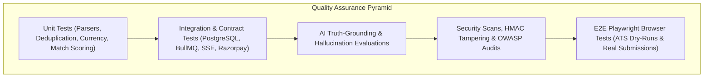

# REPORT 9 — Testing and Quality Assurance Strategy
**Platform**: Autonomous AI Job Search & Application Platform (Tsenta AI Clone)  
**Date**: October 24, 2026  
**Auditor Role**: Principal Quality Assurance Architect & Staff Security Engineer  

---

## 1. Quality Engineering Overview

Because this platform autonomously applies to real employers and executes financial billing transactions, testing cannot be an afterthought. A multi-layered testing pyramid will govern all feature implementations:

---

## 2. Test Suite Breakdown

### 2.1 Unit Testing (Vitest / Jest)
- **Resume Fact Parser**: Test extraction against 20 distinct PDF resume layouts (single-column, two-column, academic CV, tech format); assert >95% field accuracy.
- **Job Deduplication Hashing**: Test deduplication logic with identical job titles across varying URL query parameters.
- **Currency & Plan Calculations**: Assert exact math for ₹ INR, $ USD, and € EUR conversions, zero floating-point rounding errors in currency amounts.
- **HMAC Signature Checker**: Assert valid signatures pass and modified payloads fail.

### 2.2 Integration & API Contract Testing (Supertest)
- **Auth Flow**: Register -> Login -> Issue JWT -> Access Protected Route -> Refresh Token -> Logout.
- **Double-Entry Credit Ledger**: Assert that attempting 2 concurrent applications with only 1 credit allows exactly 1 to proceed while the other receives an atomic `INSUFFICIENT_CREDITS` error.
- **AdonisJS Transmit SSE**: Verify that client disconnections clean up socket descriptors and reconnection replays missed events.

### 2.3 Browser Automation & ATS Adapter Testing (Playwright)
- **Dry-Run Mode**: Every ATS adapter (Greenhouse, Ashby, Workday) must support `--dry-run`, filling all form fields, uploading the tailored resume, capturing a full-page verification screenshot, and stopping exactly 1 click before the final submit button.
- **Selector Resilience**: Use multi-strategy selectors (accessible role, text content, CSS attributes, and fallback XPath) to ensure employer UI updates do not break automation.
- **Anti-Detect Compliance**: Enforce real browser user agents, proper viewport sizing, clean residential proxy routing, and natural keystroke cadence (40–90ms per key).

### 2.4 AI Evaluation & Zero-Hallucination Benchmarks
- **Factual Consistency Test**: Feed 50 sample job descriptions to the Resume Tailoring Engine and verify that:
  - 100% of newly added keywords are present in the target job description.
  - 0% of candidate employment dates, company names, or degrees are altered.
  - No new claims (e.g., claiming 5 years of AWS when candidate only listed 1 year) are introduced.
- **ATS Format Validator**: Validate that compiled PDF resumes adhere to single-column ATS standards and are machine-parseable by standard tools (`pdftotext`, Tesseract).

### 2.5 Security Audits & Vulnerability Testing
- **OWASP Top 10 Scans**: Automated scans against SQL Injection, Cross-Site Scripting (XSS), Cross-Site Request Forgery (CSRF), and Insecure Direct Object References (IDOR).
- **Payment Tampering**: Verify that altering the `amount` or `planId` in the client payload cannot compromise the server-side order total.
- **Credential Isolation**: Assert that candidate credentials and ATS account passwords are encrypted at rest using AES-256-GCM.

---

## 3. Production Quality Metrics & SLAs

| Metric | Target SLA | Measuring Tool |
|---|---|---|
| **API Response Latency (p95)** | < 150ms | Prometheus / Grafana / Pino |
| **SSE Event Delivery Latency** | < 50ms | Client-side timestamp telemetry |
| **Job URL Freshness (Dead Links)** | 0% (Auto-purged within 30 min) | Scheduled health check cron |
| **Resume Extraction Accuracy** | > 95% on standard layouts | Automated Vitest benchmark |
| **Playwright Form Completion Rate** | > 92% on supported ATS boards | Worker execution telemetry |
| **Payment Verification Failure Rate** | 0.00% on valid transactions | Razorpay webhook reconciliation |
| **AI Hallucination Rate** | 0.00% (Strictly zero tolerated) | Pre-submit automated fact diff check |
