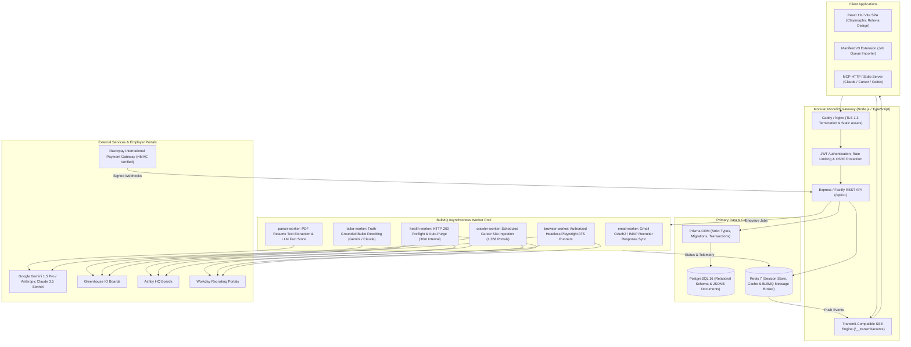
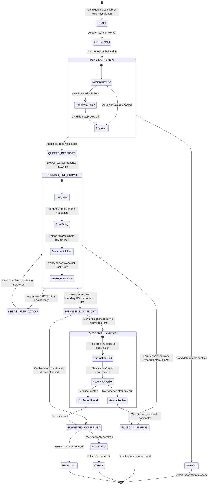

# CORRECTED ARCHITECTURE: Rolevia AI Production System Specification
**Product**: Rolevia AI (Brand Identifier: `RoleviaAI`)  
**Intended Domain**: `https://roleviaai.co.in` (with `rolevia.co.in` routing)  
**Date**: October 24, 2026  
**Auditor**: Principal Systems Architect & Lead Software Engineer  
**Status**: Final Verified Production Specification  

---

## 1. Architectural Principles & Corrections

This corrected architecture addresses every finding from the second-pass audit and user directives:

1. **Deterministic vs LLM Separation**:
   - **Deterministic Services**: Job ingestion, URL health checking, deduplication hashing, cryptographic billing verification, transactional credit journals, and document PDF compilation.
   - **LLM Reasoning Services**: Resume document parsing, candidate fact extraction, truth-grounded experience tailoring, custom screening question drafting, and recruiter email classification.
2. **Authorized, Non-Stealth Browser Automation**:
   - Zero CAPTCHA-bypassing services, stealth proxies, or anti-bot tampering.
   - Automation operates through authorized, standard Playwright browser contexts. If an employer ATS enforces an interactive MFA or CAPTCHA challenge, the runner halts and issues a `NEEDS_USER_ACTION` event to the user's dashboard.
3. **Quarantine Lifecycle for `OUTCOME_UNKNOWN`**:
   - `OUTCOME_UNKNOWN` is an explicit quarantine state with an audit trail, **never automatically treated as failed or refunded**.
   - During reconciliation, workers check candidate inbox receipts and employer portal state before releasing. Duplicate submissions are strictly blocked while in quarantine.
4. **Balanced Transactional Credit Journal**:
   - Application credits are never deducted prior to crossing the submission boundary.
   - Credits are reserved atomically (`QUEUED_RESERVED`), held during execution (`RUNNING_PRE_SUBMIT`), and committed **only** upon verified employer confirmation (`SUBMITTED_CONFIRMED`). Failed applications release the reservation, and courtesy adjustments are tracked separately in an append-only journal.
5. **Centralized Brand Configuration**:
   - All branding is decoupled from business logic and centralized in `brand.config.js`, without hardcoding DNS or assuming premature domain ownership.

---

## 2. Corrected End-to-End System Topology



---

## 3. Corrected Application State Machine & `OUTCOME_UNKNOWN` Quarantine



---

## 4. Balanced Transactional Credit Journal & Prisma Schema

```prisma
datasource db {
  provider = "postgresql"
  url      = env("DATABASE_URL")
}

generator client {
  provider = "prisma-client-js"
}

// ==========================================
// 1. Identity & Multi-Tenant User Models
// ==========================================

model User {
  id                String          @id @default(uuid())
  email             String          @unique
  passwordHash      String
  fullName          String
  phone             String?
  location          String?
  roleTitle         String?
  yearsExp          Float           @default(0)
  needsSponsorship  Boolean         @default(false)
  preferredLocations String[]
  targetRoleFamilies String[]
  creditsBalance    Int             @default(25) // Free trial credits
  createdAt         DateTime        @default(now())
  updatedAt         DateTime        @updatedAt

  resumeProfiles    ResumeProfile[]
  skills            CandidateSkill[]
  applications      Application[]
  subscription      Subscription?
  creditJournal     CreditJournal[]
  autoPilotConfig   AutoPilotConfig?
}

model CandidateSkill {
  id        String   @id @default(uuid())
  userId    String
  user      User     @relation(fields: [userId], references: [id], onDelete: Cascade)
  name      String
  category  String   @default("Technical")
  createdAt DateTime @default(now())

  @@unique([userId, name])
  @@index([userId])
}

// ==========================================
// 2. Candidate Fact Store & Resume Profiles
// ==========================================

model ResumeProfile {
  id             String         @id @default(uuid())
  userId         String
  user           User           @relation(fields: [userId], references: [id], onDelete: Cascade)
  profileName    String         @default("Master Profile")
  isDefault      Boolean        @default(true)
  pdfUrl         String
  fileSizeBytes  Int
  atsScore       Int            @default(95)
  rawParsedText  String         @db.Text
  structuredFacts Json          // Verified candidate facts (education, experience, projects, certifications)
  createdAt      DateTime       @default(now())
  updatedAt      DateTime       @updatedAt

  applications   Application[]
  @@index([userId])
}

// ==========================================
// 3. Job Directory & Requisition Deduplication
// ==========================================

model Job {
  id              String        @id @default(uuid())
  externalReqId   String?       // Requisition ID from ATS
  dedupHash       String        @unique // SHA256(company + normalizedTitle + externalReqId)
  company         String
  category        String        // startup | product | service
  logoUrl         String?
  title           String
  location        String
  region          String        // global | us | emea | apac
  sponsorship     Boolean       @default(false)
  ats             String        // greenhouse | ashby | workday
  url             String        @unique
  applyUrl        String?
  department      String?
  salaryMin       Float?
  salaryMax       Float?
  currency        String        @default("USD")
  requirements    String[]
  rawDescription  String        @db.Text
  isLive          Boolean       @default(true)
  lastCheckedAt   DateTime      @default(now())
  createdAt       DateTime      @default(now())

  applications    Application[]
  @@index([ats])
  @@index([category])
  @@index([region])
  @@index([isLive])
}

// ==========================================
// 4. Application Lifecycle & Quarantine
// ==========================================

model Application {
  id                 String            @id @default(uuid())
  userId             String
  user               User              @relation(fields: [userId], references: [id], onDelete: Cascade)
  jobId              String
  job                Job               @relation(fields: [jobId], references: [id])
  resumeProfileId    String
  resumeProfile      ResumeProfile     @relation(fields: [resumeProfileId], references: [id])
  
  status             ApplicationStatus @default(DRAFT)
  attemptUuid        String?           @unique // Unique idempotency token per submit attempt
  tailoredDiff       Json?             // [{ role, del, add, rationale }]
  tailoredPdfUrl     String?
  coverLetterText    String?           @db.Text
  confirmationNumber String?
  submittedAnswers   Json?             // { fieldName: answerValue }
  executionLog       Json?             // Array of step timestamps and screenshot URLs
  quarantineNotes    String?           // For OUTCOME_UNKNOWN reconciliation
  appliedAt          DateTime?
  createdAt          DateTime          @default(now())
  updatedAt          DateTime          @updatedAt

  creditEntries      CreditJournal[]

  @@unique([userId, jobId]) // Enforces duplicate prevention per candidate requisition
  @@index([userId, status])
}

enum ApplicationStatus {
  DRAFT
  OPTIMIZING
  PENDING_REVIEW
  QUEUED_RESERVED
  RUNNING_PRE_SUBMIT
  NEEDS_USER_ACTION
  SUBMISSION_IN_FLIGHT
  SUBMITTED_CONFIRMED
  FAILED_CONFIRMED
  OUTCOME_UNKNOWN
  SKIPPED
  INTERVIEW
  OFFER
  REJECTED
}

// ==========================================
// 5. Transactional Credit Journal (Double-Entry Balanced)
// ==========================================

model CreditJournal {
  id             String       @id @default(uuid())
  userId         String
  user           User         @relation(fields: [userId], references: [id], onDelete: Cascade)
  applicationId  String?
  application    Application? @relation(fields: [applicationId], references: [id], onDelete: SetNull)
  amount         Int          // + credit, - debit
  entryType      JournalEntryType
  balanceAfter   Int
  idempotencyKey String       @unique
  description    String
  createdAt      DateTime     @default(now())

  @@index([userId])
  @@index([applicationId])
}

enum JournalEntryType {
  SUBSCRIPTION_GRANT
  APPLICATION_HOLD
  APPLICATION_COMMIT
  APPLICATION_RELEASE
  COURTESY_ADJUSTMENT
}

// ==========================================
// 6. Subscriptions & Payments
// ==========================================

model Subscription {
  id                 String             @id @default(uuid())
  userId             String             @unique
  user               User               @relation(fields: [userId], references: [id], onDelete: Cascade)
  planId             String             // sub_starter | sub_pro | sub_power
  planName           String
  currency           String             @default("INR") // INR | USD | EUR
  priceCents         Int
  appsLimit          Int
  appsUsed           Int                @default(0)
  status             SubscriptionStatus @default(ACTIVE)
  razorpaySubId      String?            @unique
  currentPeriodStart DateTime           @default(now())
  currentPeriodEnd   DateTime
  createdAt          DateTime           @default(now())
  updatedAt          DateTime           @updatedAt

  invoices           Invoice[]
}

enum SubscriptionStatus {
  ACTIVE
  PAUSED
  PAST_DUE
  CANCELLED
}

model Invoice {
  id                 String       @id @default(uuid())
  subscriptionId     String
  subscription       Subscription @relation(fields: [subscriptionId], references: [id], onDelete: Cascade)
  amountCents        Int
  currency           String
  razorpayPaymentId  String?      @unique
  razorpayOrderId    String?      @unique
  status             String       @default("PAID")
  paidAt             DateTime     @default(now())
}

model AutoPilotConfig {
  id              String   @id @default(uuid())
  userId          String   @unique
  user            User     @relation(fields: [userId], references: [id], onDelete: Cascade)
  active          Boolean  @default(false)
  dailyVelocity   Int      @default(30)
  minSalaryUSD    Int      @default(100000)
  preferredATS    String[] @default(["greenhouse", "ashby", "workday"])
  schedule        String   @default("09:00 - 18:00 EST")
  reviewBeforeSubmit Boolean @default(true)
}

model ProcessedWebhookEvent {
  id          String   @id @default(uuid())
  provider    String   // razorpay
  eventId     String   @unique
  payloadHash String
  processedAt DateTime @default(now())
}
```

---

## 5. Security & Idempotency Hardening

1. **Cryptographic Payment Signature Verification**:
   - Compares raw byte buffers using `crypto.timingSafeEqual` against `RAZORPAY_KEY_SECRET`.
   - Webhook events are checked against `ProcessedWebhookEvent` using `eventId` to prevent duplicate processing or replay attacks.
2. **Replay & Concurrency Guards on Application Submissions**:
   - `attemptUuid` generated per submission attempt.
   - Database row-level locks on `User` and `CreditJournal` during reservation and commit.
   - `UNIQUE(userId, jobId)` constraint prevents parallel duplicate submissions to the same employer requisition.
