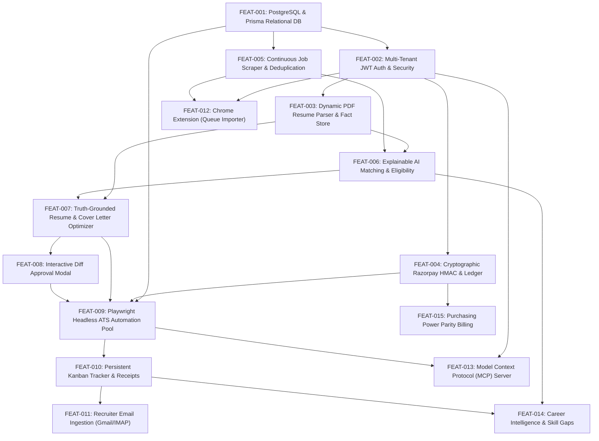

# IMPLEMENTATION DEPENDENCIES & TECHNICAL DAG
**Project**: Autonomous AI Job Search & Application Platform (Tsenta AI Clone)  
**Date**: October 24, 2026  
**Auditor**: Principal Systems Architect & Engineering Lead  
**Status**: Second-Pass Dependency & Scheduling Specification  

---

## 1. Technical Dependency DAG (Directed Acyclic Graph)

The implementation cannot proceed randomly. The technical dependencies dictate a strict sequential order to prevent building brittle code on top of unstable or missing foundations:

---

## 2. Critical Path Analysis

The **Critical Path** determines the minimum time required to deliver a fully functional, production-ready system:

$$\text{Critical Path} = \text{FEAT-001} \rightarrow \text{FEAT-002} \rightarrow \text{FEAT-003} \rightarrow \text{FEAT-007} \rightarrow \text{FEAT-008} \rightarrow \text{FEAT-009} \rightarrow \text{FEAT-010}$$

### Why This Order is Non-Negotiable:
1. **Database before Auth (FEAT-001 -> FEAT-002)**: You cannot store user credentials, password hashes, or session tokens without an ACID relational table.
2. **Auth before Resume Parser (FEAT-002 -> FEAT-003)**: A candidate Fact Store must be bound to an authenticated tenant ID; otherwise, parsed credentials leak into a shared public profile.
3. **Parser before Tailoring (FEAT-003 -> FEAT-007)**: You cannot ground resume optimizations in candidate truth unless you first extract and structure verified candidate facts.
4. **Tailoring before Diff Approval (FEAT-007 -> FEAT-008)**: The user cannot review, edit, and approve bullet point diffs until the LLM pipeline generates structured `del` and `add` candidates.
5. **Ledger & Diff before Playwright Automation (FEAT-004 & FEAT-008 -> FEAT-009)**: You cannot launch real browser submissions without first holding an atomic credit reservation and possessing candidate-approved resume assets.

---

## 3. Dependency-Aware Complexity & Effort Estimation

| Feature ID | Feature Name | Technical Complexity | Effort Estimate (Days) | Risk Level | Primary Technical Blocker / Friction Point |
|---|---|---|---|---|---|
| **FEAT-001** | PostgreSQL & Prisma DB Migration | Medium | 4 days | Low | Data migration from `store.json` without breaking active dev server. |
| **FEAT-002** | Multi-Tenant JWT Auth & Security | Medium | 3 days | Low | Cookie configuration (`SameSite=Strict`, `Secure`) and middleware gating. |
| **FEAT-003** | Dynamic PDF Resume Parser | High | 4 days | Medium | Extracting clean text from multi-column or non-standard PDF formats. |
| **FEAT-004** | Razorpay HMAC & Credit Ledger | Medium | 2 days | Low | Webhook signature matching and double-entry transaction locks. |
| **FEAT-005** | Job Scraper & Deduplication | High | 4 days | Medium | Handling rate limits across 1,358 career sites; requisition ID normalization. |
| **FEAT-006** | Explainable AI Matching | Medium | 3 days | Low | Embedding latency and cost; tuning hard constraint rules. |
| **FEAT-007** | Truth-Grounded Resume Optimizer | High | 4 days | High | Prompt engineering enforcing 0% hallucination and strict keyword bounds. |
| **FEAT-008** | Interactive Diff Approval Modal | Medium | 2 days | Low | Bidirectional state syncing between candidate edits and PDF generator. |
| **FEAT-009** | Playwright Headless ATS Runner | Very High | 7 days | High | Dynamic DOM changes on Workday; handling multi-step frames and timeouts. |
| **FEAT-010** | Kanban Tracker & Receipt Engine | Medium | 3 days | Low | Drag-and-drop UI state synchronization with database. |
| **FEAT-011** | Recruiter Email Ingestion | High | 4 days | Medium | Gmail OAuth2 consent verification; parsing recruiter email text. |
| **FEAT-012** | Chrome Extension Importer | Medium | 4 days | Low | Content script isolation and background service worker communication. |
| **FEAT-013** | Model Context Protocol (MCP) | Medium | 3 days | Low | Implementing JSON-RPC protocol over stdio and HTTP. |
| **FEAT-014** | Career Intelligence Analytics | Low | 3 days | Low | Aggregating market keyword frequencies across ingested job pool. |
| **FEAT-015** | Purchasing Power Parity Billing | Low | 2 days | Low | Managing geo-IP currency detection and localized pricing rules. |

**Total Estimated Implementation Effort**: **52 Engineering Days** across 4 releases.

---

## 4. Risk Mitigation & Contingency Protocols

### Risk 1: Employer Portal DOM Mutation (Workday / Greenhouse)
- **Impact**: Playwright selector breaks, causing application failure.
- **Contingency Plan**:
  1. Use resilient accessible locators (`page.getByRole('textbox', { name: /email/i })`) instead of brittle CSS IDs.
  2. Implement an automated fallback strategy trying multiple selector tiers.
  3. Emit a `NEEDS_USER_ACTION` event if form filling fails, allowing the candidate to complete the step manually in their browser.

### Risk 2: LLM Hallucination in Resume Tailoring
- **Impact**: Candidate submitted with false credentials, risking disqualification.
- **Contingency Plan**:
  1. Enforce a deterministic post-processing verification check comparing all newly generated tokens against the candidate's verified Fact Store.
  2. If any unauthorized fact is detected, reject the diff and fall back to the unedited master resume bullet.
