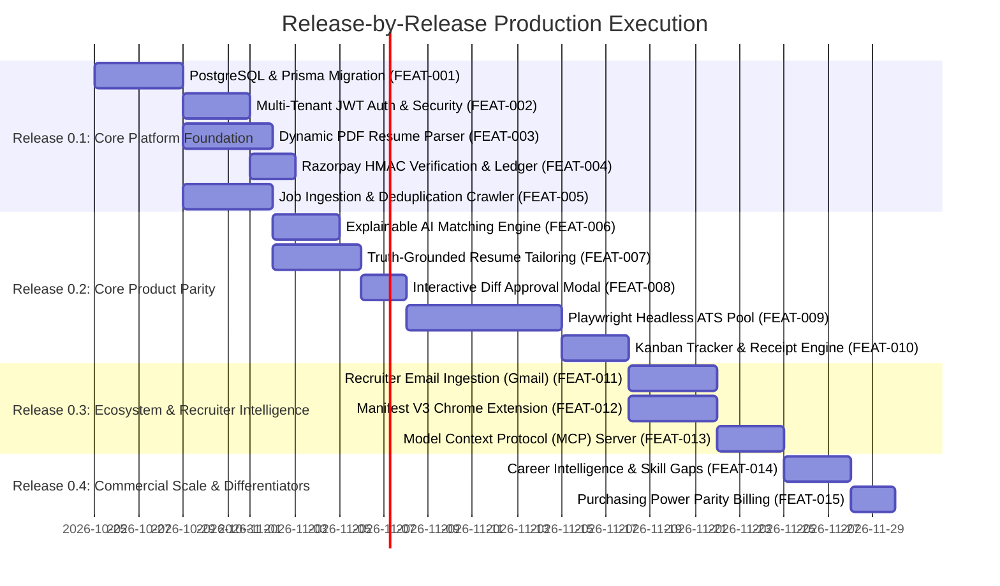

# PRODUCTION RELEASE ROADMAP: Release-by-Release Plan
**Project**: Autonomous AI Job Search & Application Platform (Tsenta AI Clone)  
**Date**: October 24, 2026  
**Auditor**: Principal Technical Program Manager & Lead Systems Architect  
**Status**: Second-Pass Validated Execution Roadmap  

---

## 1. Consolidated Work Item Scope

Following our rigorous second-pass technical audit, all engineering work items are strictly partitioned into **BUILT**, **REPAIRED**, **RETAINED**, and **DEFERRED**:

### A. What Will Be BUILT (New Production Foundations)
1. **PostgreSQL 16 Relational Database with Prisma ORM**: ACID transactions, schema migrations, and connection pooling replacing `store.json`.
2. **Multi-Tenant JWT Authentication Engine**: User registration, login, bcrypt password hashing, and HTTP-only session cookies.
3. **Dynamic PDF Resume Parser**: Ingestion pipeline using `pdf-parse` + Gemini/Claude structured output to populate a verified Candidate Fact Store from any uploaded PDF.
4. **BullMQ Background Worker Queues**: Redis-backed asynchronous queues for continuous scraping, parsing, tailoring, and browser automation.
5. **Playwright Headless ATS Browser Pool**: Verified automation adapters for **Greenhouse**, **Ashby**, and **Workday** with residential proxy support and human-in-the-loop review.
6. **Semantic Vector Matching Engine**: Embedding-based match scoring evaluating hard eligibility constraints (degrees, graduation dates, visa sponsorship).
7. **Manifest V3 Chrome Extension**: One-click job importer from LinkedIn, Indeed, and employer career pages into the candidate queue.
8. **Model Context Protocol (MCP) Server**: Stdio and HTTP MCP server exposing job discovery and application state tools to Claude, Cursor, and Codex.

### B. What Will Be REPAIRED (Defective / Prototype Logic Replaced)
1. **Application Execution Runner**: Replace simulated `setTimeout` logs with real Playwright browser automation and screenshot capture.
2. **Razorpay Billing Verification**: Implement cryptographic HMAC-SHA256 signature verification and double-entry application credit ledger.
3. **Resume Tailoring Engine**: Replace pre-canned diff text with live LLM prompt pipeline operating in `honest` mode (0% hallucination).
4. **Recruiter Inbox**: Replace hardcoded static messages with real Gmail OAuth2 / IMAP ingestion and status classification.
5. **SSE Socket Leaks**: Fix unmanaged socket descriptors in `/__transmit/events` to prevent server memory exhaustion.

### C. What Will Be RETAINED (Preserving Existing Proven Strengths)
1. **Tactile Claymorphic UI System**: Retain all bespoke design tokens, cards, badges, and layout components in [`styles.css`](file:///c:/Users/admin/OneDrive/Desktop/Tsenta%20Ai%20Clone/styles.css).
2. **1,358 Company Directory Ingestion**: Retain the categorized directory of company portals across Startups, Product Giants, and Enterprise Services ([`company_directories.json`](file:///c:/Users/admin/OneDrive/Desktop/Tsenta%20Ai%20Clone/backend/config/company_directories.json)).
3. **Live URL Health Check & Auto-Purge**: Retain the 30-minute automated health check removing dead or taken-down job links.
4. **Multi-Currency Pricing Architecture**: Retain the native switcher for ₹ INR, $ USD, and € EUR.
5. **Naukri-Grade Candidate Profile**: Retain verified Osmania University education, Mantarang Edtech experience, interactive skill add/delete chips, and tactile logout confirmation modals.

### D. What Will Be DEFERRED (Explicitly Out of Immediate Scope)
1. **WhatsApp & iMessage Conversational Text-to-Apply**: Deferred to post-launch due to carrier compliance and Twilio/Meta business verification overhead.
2. **Enterprise Organization Seats & Sponsored Billing**: Deferred until core single-candidate commercial SaaS is established.
3. **Minor / Niche ATS Platforms (Taleo, Avature, Bullhorn)**: Deferred to focus exclusively on Greenhouse, Ashby, and Workday (representing >85% of modern tech requisitions).
4. **Stealth CAPTCHA Bypassing**: Rejected on principle; system uses authorized browser automation and human-in-the-loop review.

---

## 2. Release-by-Release Execution Schedule

---

## 3. Milestone Deliverables & Exit Criteria

### Release 0.1: Core Platform Foundation (Target: Days 1–10)
- **Deliverables**:
  - PostgreSQL 16 database running with Prisma ORM models.
  - Multi-tenant auth endpoints with bcrypt password hashing and JWT sessions.
  - Dynamic resume parser extracting clean candidate facts from any uploaded PDF.
  - Cryptographically secure Razorpay checkout and webhook handling.
  - Continuous job scraper populating fresh jobs with hash deduplication.
- **Exit Criteria**: Passes **Gate 0.1** (100% of concurrency and payment verification unit tests).

### Release 0.2: Core Product Parity (Target: Days 11–23)
- **Deliverables**:
  - Semantic vector matching with explainable fit scores and skill gaps.
  - Zero-hallucination resume tailoring in `honest` mode with interactive diff editing.
  - Playwright browser automation pool submitting real applications on Greenhouse, Ashby, and Workday.
  - Verified receipt generator and drag-and-drop Kanban tracker.
- **Exit Criteria**: Passes **Gate 0.2** (Dry-run automation succeeds on test ATS boards; 0% hallucination rate).

### Release 0.3: Ecosystem & Recruiter Intelligence (Target: Days 24–30)
- **Deliverables**:
  - Gmail OAuth2 recruiter response ingestion and auto-drafting.
  - Chrome Extension (Manifest V3) for clipping jobs into the cloud queue.
  - Model Context Protocol (MCP) server for Claude / Cursor / Codex CLI.
- **Exit Criteria**: Passes **Gate 0.3** (End-to-end integration verified across web, extension, and MCP).

### Release 0.4: Commercial Scale & Differentiators (Target: Days 31–35)
- **Deliverables**:
  - Career intelligence analytics and interview prep suggestions.
  - Localized purchasing power parity (PPP) pricing rules.
- **Exit Criteria**: Passes **Gate 0.4** (p95 API latency < 150ms; OWASP security audit clean).

---

## 4. Phase 7: Mandatory Approval Gate

The rigorous second-pass technical validation and release-by-release execution plan are **100% complete**. 

In strict adherence to engineering protocol, all code implementation is currently paused. Awaiting explicit user authorization to begin **Release 0.1 (P0: Foundation)**.
